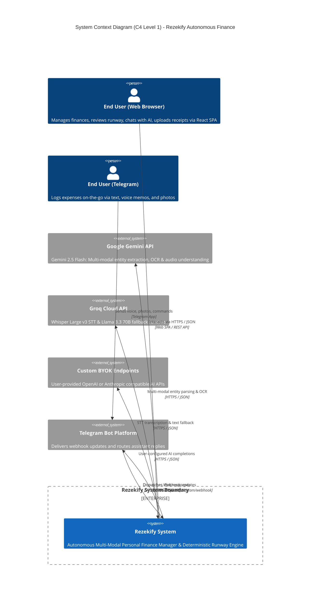
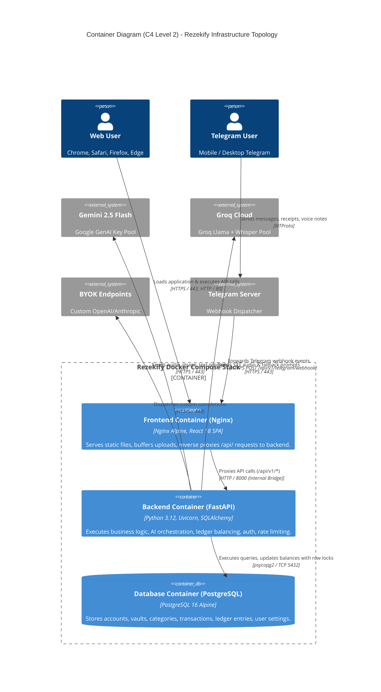
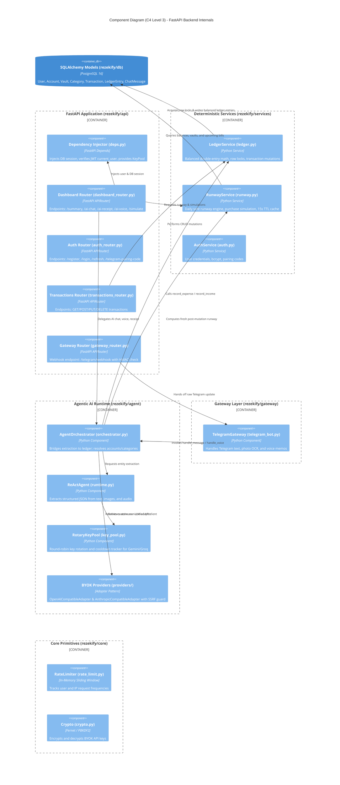
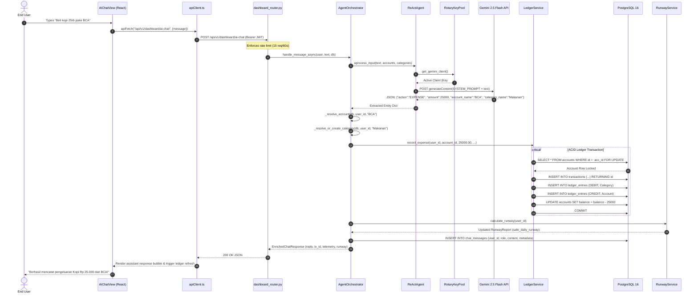
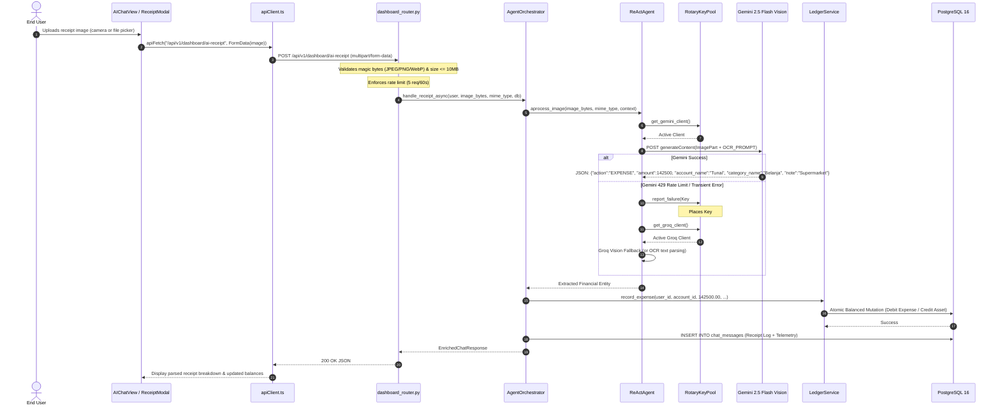
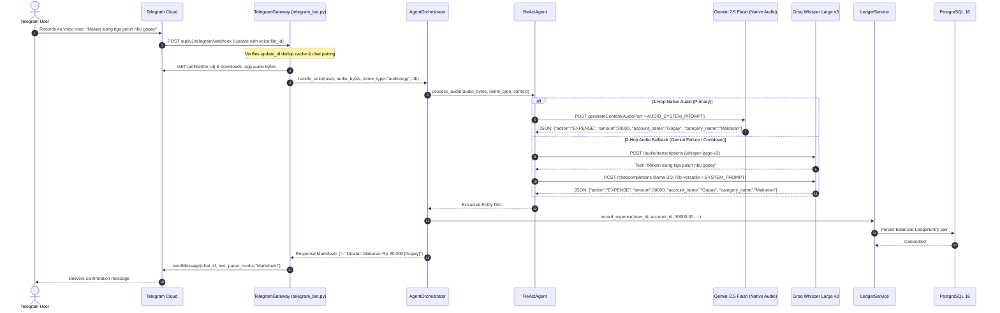
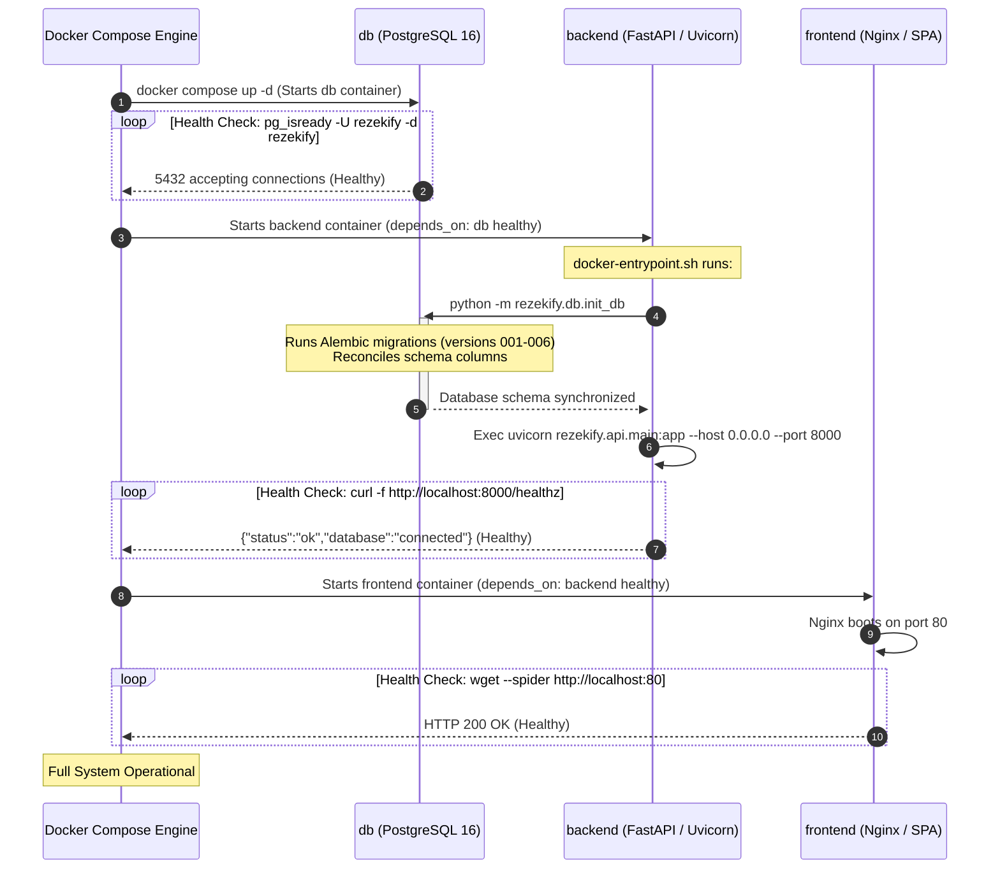

# Rezekify — Master System Architecture Document (SAD)

**Document ID:** ARCH-001 | **Version:** 1.0.0 | **Frameworks:** Arc42, C4 Model (Levels 1–3)  
**Target Environment:** Docker Compose (PostgreSQL 16 + FastAPI + Nginx) | **Status:** Active  

---

## Section 1: Executive Summary & Architectural Drivers

### 1.1 System Identity & Core Purpose

Rezekify is an **Autonomous Multi-Modal Personal Finance Manager & Deterministic Runway Engine**. The platform unifies unstructured user interactions—conversational Indonesian natural language, receipt photographs, and voice memos transmitted via web dashboard or Telegram—into mathematically deterministic, double-entry financial ledger records.

At the core of personal financial failure is not a lack of accounting software, but the cognitive overhead of manual transaction entry and the inability to answer a simple daily question: *"How much money can I safely spend today without defaulting on my upcoming bills?"* Rezekify automates the ingestion pipeline via agentic multi-modal extraction while strictly preventing Large Language Models (LLMs) from executing financial arithmetic or directly mutating balances.

The entire system is governed by **Five Architectural Invariants**:

1. **Deterministic Math**: LLMs extract transaction intent and entities, but **never calculate money**. All balance changes, arithmetic, daily runway projections, and simulations are computed deterministically using Python's `decimal.Decimal` within `rezekify/services/ledger.py` (`LedgerService`) and `rezekify/services/runway.py` (`RunwayService`).
2. **Balanced Double-Entry Ledger**: Every transaction mutation records paired debit and credit entries (`LedgerEntry`) satisfying the fundamental accounting equation $\sum \text{Debit} = \sum \text{Credit}$. Unilateral balance modifications are physically impossible by design.
3. **Row-Level Multi-Tenant Isolation**: Every database interaction, whether read or write, strictly filters by the authenticated user's scope (`WHERE user_id = current_user_id`). Multi-tenant data leakage is prevented at both the service and query layers.
4. **Zero-Cost Rotary Key Pool**: High-availability multi-modal intelligence is sustained on public zero-cost infrastructure through round-robin API key rotation, dynamic cooldown tracking, and automated fallbacks across Google Gemini 2.5 Flash and Groq free tiers (`RotaryKeyPool`), augmented by Bring-Your-Own-Key (BYOK) adapters.
5. **Zero-Bloat Scope**: The analytical domain is intentionally bounded to the **Daily Safe Runway** metric and **H-7 Upcoming Bills** alerts. Features that introduce cognitive bloat (complex investment tracking, social feeds, credit score modeling) are deliberately omitted.

---

### 1.2 Fundamental Architectural Drivers

```
┌─────────────────────────────────────────────────────────────────────────────┐
│                       REZEKIFY ARCHITECTURAL DRIVERS                         │
├───────────────────────┬─────────────────────────────────────────────────────┤
│ 1. Determinism        │ Strict separation: LLM entity extraction vs.        │
│                       │ decimal.Decimal double-entry balanced arithmetic.   │
├───────────────────────┼─────────────────────────────────────────────────────┤
│ 2. Multi-Modal Input  │ Ingestion of text, camera receipts, and audio notes │
│                       │ via Web SPA and Telegram Webhook Bot.               │
├───────────────────────┼─────────────────────────────────────────────────────┤
│ 3. Zero-Cost Rotary AI│ High-resilience key pool with cooldown management   │
│                       │ spanning Gemini 2.5 Flash & Groq (Whisper + Llama). │
├───────────────────────┼─────────────────────────────────────────────────────┤
│ 4. Multi-Tenant Safety│ Row-level tenant isolation (WHERE user_id = :uid),   │
│                       │ JWT access/refresh rotation, Fernet key encryption. │
├───────────────────────┼─────────────────────────────────────────────────────┤
│ 5. Zero-Bloat Domain  │ Focused metric engine: Daily Safe Runway + H-7      │
│                       │ Upcoming Fixed Bills with zero non-essential scope. │
└───────────────────────┴─────────────────────────────────────────────────────┘
```

---

### 1.3 Arc42 Quality Goals

The architecture of Rezekify optimizes for the following quality attributes, prioritized according to system safety and real-time user feedback:

| Quality Attribute | Quality Scenario | Priority | Architectural Mechanism |
|---|---|---|---|
| **Correctness** | A user records high-frequency expenses and transfers across e-wallets and bank accounts. | **P0 (Absolute)** | `LedgerService` enforces `decimal.Decimal(15, 2)` arithmetic, database-level `with_for_update()` row-level locking on balance rows, and atomic paired debit/credit `LedgerEntry` generation inside ACID transactions. |
| **Tenant Isolation** | An authenticated user attempts to access or mutate ledger entries, vaults, or settings belonging to another tenant. | **P0 (Absolute)** | Mandatory dependency injection `get_current_user()` validating JWT subject (`sub`), combined with hard-coded `user_id = current_user.id` predicates across all SQLAlchemy queries in services and API routers. |
| **Availability** | External free-tier AI APIs (Google Gemini) hit 429 Rate Limits or transient network outages during transaction parsing. | **P1 (High)** | `RotaryKeyPool` key rotation across multiple configured API keys, dynamic cooldown tracking with exponential backoff, and automatic fallback from Gemini 2.5 Flash to Groq (`llama-3.3-70b-versatile` / `whisper-large-v3`). |
| **Security** | A malicious tenant configures a custom BYOK provider pointing to local network metadata endpoints (e.g., `http://169.254.169.254/`). | **P1 (High)** | `validate_base_url()` in `rezekify/agent/providers/base.py` enforces HTTPS and rejects loopback, RFC 1918 private, link-local, and reserved IP ranges via `ipaddress` parsing before HTTP dispatch. |
| **Performance** | Repeated dashboard loading requests for Runway computation under concurrent user activity. | **P1 (High)** | In-memory TTL caching (`RunwayService._cache`) with 15-second expiration, max 5,000 entries, and lazy amortized eviction sweeps every 60 seconds; composite index `idx_transactions_user_date`. |
| **Modifiability** | Integration of alternative proprietary or self-hosted LLM backends by advanced users. | **P2 (Medium)** | Decoupled BYOK adapter architecture (`OpenAICompatibleAdapter`, `AnthropicCompatibleAdapter`) implementing `BaseAIProvider` protocol, configurable per-user via `UserSettings`. |
| **Usability** | Casual users submit messy Indonesian colloquial voice messages (e.g., *"Beli nasi padang 25 ribu pake gopay tadi siang"*). | **P2 (Medium)** | Indonesian-localized system prompts in `ReActAgent`, 1-Hop direct native Gemini audio parsing with 2-Hop Groq Whisper STT + LLM entity resolution fallback, fuzzy account name matching. |
| **Testability** | Regression testing of ledger logic, purchase simulations, and parsing without consuming live LLM API credits. | **P2 (Medium)** | Unit-testable separation between deterministic services (`LedgerService`, `RunwayService`) and AI agent layer; mockable provider protocols and in-memory SQLite support via `StaticPool`. |

---

### 1.4 Technical Constraints & Operating Limits

| Constraint | Specification / Operating Limit | Architectural Impact |
|---|---|---|
| **Runtime Language** | Python 3.12+ (Backend), TypeScript 5+ on Node 20 / Vite 5 (Frontend) | Leverages modern Python type hinting, `dataclasses`, `asyncio`, and strict TS interfaces for schema validation. |
| **Database Engine** | PostgreSQL 16 on Alpine Linux | Relies on ACID transactions, `Numeric(15, 2)` column precision, and PostgreSQL-specific row-locking syntax (`FOR UPDATE`). |
| **Connection Pooling** | `pool_size=3`, `max_overflow=2`, `pool_recycle=1800`, `pool_pre_ping=True` | Constrained connection footprint designed for low-memory micro-containers (VPS deployment). Max 5 concurrent DB connections per backend worker. |
| **Password Hashing** | Bcrypt with strict 72-byte pre-truncation | Passwords longer than 72 bytes are truncated in `rezekify/core/security.py` prior to hashing to prevent bcrypt truncation vulnerabilities. |
| **Auth Tokens** | JWT HS256: 30-minute Access Token, 7-day Refresh Token | Access token transmitted in `Authorization: Bearer` header; Refresh token persisted in secure `HttpOnly`, `SameSite=Lax` cookie. |
| **Payload Limits** | 10 MB maximum upload size on `/ai-receipt` and `/ai-voice` | Uploaded image and audio payloads validated via magic bytes (`image/jpeg`, `image/png`, `image/webp`) and processed strictly in-memory without disk persistence. |
| **Rate Limiter Cap** | Sliding-window limiter tracking up to 5,000 distinct IP/User keys | Rate limits enforced: Auth (10 req/60s), AI Chat (15 req/60s), AI Receipt (5 req/60s), AI Validation (10 req/60s). |
| **Secret Encryption** | Fernet encryption using PBKDF2 (600,000 SHA-256 iterations) | BYOK API keys encrypted before saving to `user_settings.encrypted_ai_api_key`; encryption key derived from `ENCRYPTION_KEY` or `SECRET_KEY`. |

---

## Section 2: System Context (C4 Level 1)

### 2.1 Context Actors

1. **End User (Web Client)**: Accesses Rezekify via an authenticated modern web browser (React 18 Single Page Application) on mobile, tablet, or desktop. Performs conversational tracking, monitors daily runway gauges, and manages vault allocations.
2. **End User (Telegram Messenger)**: Sends quick voice notes, receipt photos, or Indonesian text messages directly to the `@RezekifyBot`. Pairs account via a one-time OTP pairing code (`DK-XXXXXX`).
3. **Automated AI Services (Public Free-Tier)**:
   - **Google Gemini 2.5 Flash**: Primary multimodal LLM for natural language entity extraction, receipt visual OCR, and 1-hop native audio transcription.
   - **Groq Cloud**: Primary fallback provider running open-weights models (`llama-3.3-70b-versatile` for text/reasoning and `whisper-large-v3` for speech-to-text).
4. **Custom BYOK AI Providers**: Optional third-party AI endpoints supplied by power users (OpenAI API, Anthropic Messages API, OpenRouter, or private Ollama instances).

---

### 2.2 External Systems & Integrations

| External System | Interface / Protocol | Direction | Operational Purpose |
|---|---|---|---|
| **Google Gemini API** | HTTPS / REST (`google-genai` SDK v0.1+) | Outbound | Text entity parsing, receipt image OCR parsing, native voice note audio comprehension. |
| **Groq API** | HTTPS / REST (`groq` SDK v0.9+) | Outbound | High-speed fallback for text extraction and 2-Hop audio transcription via Whisper Large v3. |
| **Telegram Bot API** | HTTPS / REST (Webhook POST) | Inbound & Outbound | Receives updates (text, audio, photo) via webhook; sends Markdown response messages to paired chats. |
| **BYOK OpenAI Endpoints** | HTTPS / REST (`/v1/chat/completions`, `/v1/audio/transcriptions`) | Outbound | User-provided OpenAI-compatible endpoints for custom LLM processing. |
| **BYOK Anthropic Endpoints**| HTTPS / REST (`/v1/messages`) | Outbound | User-provided Anthropic Claude endpoints for text-based entity extraction. |
| **PostgreSQL Database** | TCP / PostgreSQL Wire Protocol (`psycopg2-binary`) | Internal | Relational persistence for double-entry ledger, accounts, vaults, categories, settings, and users. |

---

### 2.3 C4 Level 1 System Context Diagram



---

## Section 3: Container Architecture (C4 Level 2)

### 3.1 Container Inventory

The deployment unit comprises three cohesive containers orchestrated via `docker-compose.yml` on an isolated bridge network (`rezekify_net`):

| Container Name | Technology Base | Primary Responsibility | Exposed / Internal Port |
|---|---|---|---|
| **frontend** | Nginx 1.25+ Alpine, React 18 SPA (Vite, TS, Tailwind CSS) | Serves production web assets, terminates client HTTP, reverse-proxies `/api/` traffic to the backend container. | Host: `80:80` (or `8080:80`) |
| **backend** | Python 3.12-slim, FastAPI, Uvicorn, SQLAlchemy 2.0 | Executes deterministic ledger/runway logic, manages AI key pools, handles webhooks, enforces auth and rate limits. | Internal: `8000` (Docker Network) |
| **db** | PostgreSQL 16 Alpine | ACID relational storage, foreign key enforcement, row-level locking for double-entry records. | Internal: `5432` (Docker Network) |

---

### 3.2 C4 Level 2 Container Diagram



---

### 3.3 Container Communication Topology

1. **Client to Frontend**:
   - The browser initiates HTTP requests to Nginx on Port 80 (or 443 in TLS configurations).
   - Nginx inspects the URI prefix. Static assets (`/assets/*`, `index.html`) are served directly from `/usr/share/nginx/html`.
   - Requests matching `/api/` are forwarded via reverse proxy directive `proxy_pass http://backend:8000/api/` with preserved headers (`Host`, `X-Real-IP`, `X-Forwarded-For`, `X-Forwarded-Proto`).
2. **Backend to Database**:
   - The FastAPI backend communicates with the PostgreSQL container over the private Docker network `rezekify_net` on TCP port 5432 using `psycopg2-binary`.
   - SQLAlchemy creates a persistent connection pool (`pool_size=3`, `max_overflow=2`) with `pre_ping=True` to detect and discard stale connections.
3. **Backend to External AI Services**:
   - The backend creates asynchronous `httpx.AsyncClient` connections or uses the official client SDKs (`google-genai`, `groq`) over outbound HTTPS (Port 443).
   - All outbound requests operate with strict timeout bounds (typically 15s to 90s) to prevent thread starvation.
4. **Telegram to Backend**:
   - Telegram sends webhook POST requests to `/api/v1/telegram/webhook`.
   - Nginx streams the payload to FastAPI, where `gateway_router.py` validates the request signature using `secrets.compare_digest(token, settings.TELEGRAM_BOT_TOKEN)` before dispatching to `TelegramGateway`.

---

### 3.4 Subsystem Specifications

#### Container: `frontend`
- **Inputs**: HTTP GET requests for static assets; WebSocket/HTTP API responses forwarded from backend.
- **Outputs**: Rendered HTML5/CSS3/JavaScript bundle; user requests routed to `/api/v1/*`.
- **Internal Storage**: Ephemeral browser `localStorage` (theme preferences, active view tabs); session state held in React Context (`AuthContext`). Refresh token stored in browser cookie jar.
- **Protocol Contracts**: Consumes OpenAPI v3 JSON schema exposed by FastAPI; produces application/json or multipart/form-data.

#### Container: `backend`
- **Inputs**: JSON REST requests, `multipart/form-data` uploads (receipt images, voice memos), Telegram webhook payloads.
- **Outputs**: JSON responses conforming to Pydantic schemas (`DashboardSummaryResponse`, `TransactionResponse`, `EnrichedChatResponse`); outbound Telegram Markdown replies.
- **Internal Storage**: In-memory LRU/TTL caches (`RunwayService._cache`, `RateLimiter.buckets`, `TelegramGateway._dedup_cache`, `RotaryKeyPool._cooldowns`).
- **Protocol Contracts**: Enforces HTTP status codes (200, 201, 400, 401, 403, 404, 422, 429, 500); provides healthcheck at `/healthz`.

#### Container: `db`
- **Inputs**: PostgreSQL wire protocol packets containing SQL statements (`SELECT`, `INSERT`, `UPDATE`, `DELETE`, `BEGIN`, `COMMIT`, `ROLLBACK`).
- **Outputs**: Relational tabular recordsets; transaction status codes; error constraints.
- **Internal Storage**: PostgreSQL data files mounted to host volume `rezekify_postgres_data` at `/var/lib/postgresql/data`.
- **Protocol Contracts**: PostgreSQL 16 dialect, strict ACID transaction isolation (`READ COMMITTED` default, row-level locks via `SELECT ... FOR UPDATE`).

---

## Section 4: Component Architecture (C4 Level 3)

### 4.1 Backend Component Decomposition

The backend service (`rezekify/`) is structured into distinct functional layers enforcing separation of concerns:

```
rezekify/
├── core/               # Cross-cutting primitives: config, security, encryption, rate limiting
├── db/                 # Persistence layer: SQLAlchemy models, session factory, migrations
├── services/           # Deterministic business logic (Ledger, Runway, Auth)
├── agent/              # Multi-modal entity extraction runtime, key pool, BYOK providers
├── gateway/            # External interface adapters (Telegram Bot)
├── schemas/            # Pydantic v2 data transfer objects & validation schemas
└── api/                # FastAPI application, dependency injection, REST routers
```

1. **Core Configuration (`rezekify/core/config.py`)**:
   - `Settings`: Pydantic BaseSettings class loading environment variables (`DATABASE_URL`, `SECRET_KEY`, `GEMINI_API_KEYS`, `GROQ_API_KEYS`, `TELEGRAM_BOT_TOKEN`, `ENCRYPTION_KEY`, `ALLOWED_ORIGINS`).
   - Production validation: Rejects default insecure `SECRET_KEY` when `ENVIRONMENT=production`.
2. **Security & Cryptography (`rezekify/core/security.py`, `rezekify/core/crypto.py`)**:
   - `hash_password()`, `verify_password()`: Bcrypt hashing with 72-byte pre-truncation.
   - `create_access_token()`, `create_refresh_token()`: HS256 JWT encoding with standard claims (`sub`, `exp`, `type`).
   - `encrypt_key()`, `decrypt_key()`, `mask_key()`: Fernet symmetric encryption derived via PBKDF2 (600,000 iterations of SHA-256).
3. **Sliding-Window Rate Limiter (`rezekify/core/rate_limit.py`)**:
   - `RateLimiter`: In-memory sliding window using `collections.deque` and `time.monotonic()`. Differentiates authenticated users (`user:{uuid}`) from anonymous IPs (`ip:{host}`).
4. **Data Persistence (`rezekify/db/`)**:
   - `models.py`: 9 SQLAlchemy ORM models (`User`, `Account`, `Vault`, `Category`, `Transaction`, `LedgerEntry`, `UserSettings`, `ChatMessage`, `GUID`).
   - `session.py`: Database engine instantiation, `SessionLocal` factory, and `get_db()` context manager.
   - `init_db.py`: Database initialization script executing Alembic migrations (`alembic upgrade head`) with retry loops and schema reconciliation.
5. **Deterministic Ledger Service (`rezekify/services/ledger.py`)**:
   - `LedgerService`: Executes financial ledger mutations (`record_expense`, `record_income`, `record_transfer`, `update_transaction`, `delete_transaction`).
   - Guarantees zero floating-point arithmetic using `decimal.Decimal`.
   - Enforces balanced DEBIT/CREDIT pairs on `LedgerEntry`.
   - Uses `with_for_update()` row locking on affected `Account` records (sorted by ID to prevent deadlocks).
6. **Deterministic Runway Service (`rezekify/services/runway.py`)**:
   - `RunwayService`: Calculates daily safe runway:
     $$\text{Daily Safe Runway} = \frac{\text{Liquid Cash} - \text{Vault Allocations}}{\text{Days Remaining in Cycle}}$$
   - Projects purchase simulations (`simulate_purchase()`), computes category breakdowns, upcoming H-7 fixed bills, and manages an in-memory 15s TTL cache.
7. **Authentication Service (`rezekify/services/auth.py`)**:
   - `AuthService`: Manages user registration, credential verification, pairing code generation (`DK-XXXXXX`), and Telegram chat ID association.
8. **Agent Orchestrator (`rezekify/agent/orchestrator.py`)**:
   - `AgentOrchestrator`: Bridges unstructured AI extraction and deterministic ledger mutations. Resolves accounts by fuzzy naming (`_resolve_account`), auto-creates categories (`_resolve_or_create_category` with SQL wildcard sanitization), logs `ChatMessage`, and attaches telemetry metadata.
9. **ReAct Agent Runtime (`rezekify/agent/runtime.py`)**:
   - `ReActAgent`: Multi-modal extraction engine. Manages system prompts localized in Indonesian (`SYSTEM_PROMPT`, `AUDIO_SYSTEM_PROMPT`). Parses unstructured text, receipt images, and audio payloads into strict JSON: `{action, amount, account_name, category_name, note}`.
10. **Rotary Key Pool (`rezekify/agent/key_pool.py`)**:
    - `RotaryKeyPool`: Round-robin rotation over comma-separated API keys. Tracks per-key cooldown timers upon hitting rate limits (HTTP 429) or transient errors (HTTP 503).
11. **BYOK Adapter Architecture (`rezekify/agent/providers/`)**:
    - `base.py`: Protocol definition `BaseAIProvider`, `BYOKConfig`, error hierarchy (`AuthError`, `RateLimitError`, `CapabilityUnsupported`), and SSRF URL validator `validate_base_url()`.
    - `openai_compatible.py`: `OpenAICompatibleAdapter` implementing chat completions and Whisper audio transcriptions.
    - `anthropic_compatible.py`: `AnthropicCompatibleAdapter` implementing Claude messages API.
12. **API Gateways & Routers (`rezekify/api/v1/`)**:
    - 9 FastAPI routers (`auth_router`, `dashboard_router`, `transactions_router`, `accounts_router`, `categories_router`, `vaults_router`, `gateway_router`, `settings_router`).
13. **Telegram Gateway (`rezekify/gateway/telegram_bot.py`)**:
    - `TelegramGateway`: Webhook handler parsing Telegram updates. Features 5-minute deduplication cache (10,000 update IDs) and OTP pairing rate limiting.

---

### 4.2 C4 Level 3 Component Diagrams



---

### 4.3 Frontend Component Decomposition

The frontend (`frontend/src/`) is built with React 18, TypeScript, Vite, Tailwind CSS, and HeroUI:

```
frontend/src/
├── components/          # Reusable UI widgets and presentation views
│   ├── AIChatView.tsx           # Conversational AI Hub (text, voice recorder, receipt upload)
│   ├── AISpotlightHero.tsx      # Top-level actionable runway summary hero
│   ├── RunwayMetricCard.tsx     # Traffic-light safe daily runway gauge
│   ├── OverviewView.tsx         # Dashboard landing view composing metrics and charts
│   ├── ExpenseCharts.tsx        # Visual categorical and daily spending graphs
│   ├── TransactionsTable.tsx    # Paginated double-entry ledger ledger table
│   ├── VaultCard.tsx            # Locked vs. liquid reserve allocation cards
│   ├── CategoryManagerModal.tsx # Category CRUD management dialog
│   └── SettingsModal.tsx        # Profile, BYOK keys, and Telegram pairing modal
├── hooks/               # Custom lifecycle and state management hooks
│   ├── useDashboardData.ts      # Aggregated dashboard data hook with 30s cache
│   ├── useTransactionsLedger.ts # Paginated transaction fetching, filtering, CRUD
│   └── useDashboardModals.ts    # Centralized modal visibility coordinator
├── context/             # Global application state providers
│   └── AuthContext.tsx          # JWT session state, login, refresh, logout orchestration
├── services/            # HTTP networking abstraction
│   └── apiClient.ts             # Authenticated fetch wrapper with 401 token refresh queue
└── types/               # TypeScript data transfer models matching backend schemas
    └── api.ts                  # User, Account, Transaction, Runway, Chat interfaces
```

---

### 4.4 Critical End-to-End Sequence: NL Text → Ledger Mutation



---

### 4.5 Critical End-to-End Sequence: Receipt Image OCR



---

### 4.6 Critical End-to-End Sequence: Telegram Voice Note



---

## Section 5: Cross-Cutting Concerns

### 5.1 Security, Authentication & Authorization

1. **Authentication Token Lifecycle**:
   - Access tokens (`access_token`) are short-lived JSON Web Tokens (30-minute validity) signed via HS256 containing user identity claims (`sub: <user_uuid>`, `type: "access"`). Transmitted via the `Authorization: Bearer <token>` header.
   - Refresh tokens (`refresh_token`) are long-lived (7-day validity) signed JWTs (`type: "refresh"`). Transmitted strictly within a hardened `HttpOnly`, `SameSite=Lax`, `Secure` (in production) HTTP cookie.
   - Token refresh via POST `/api/v1/auth/refresh` rotates both access and refresh tokens, invalidating compromised session chains.
2. **Password Hashing & Ingestion Sanitization**:
   - Password hashing is implemented in `rezekify/core/security.py` using direct `bcrypt`.
   - Passwords undergo explicit 72-byte truncation (`password.encode('utf-8')[:72]`) prior to hashing, mitigating password exhaustion attacks and library truncation mismatches.
3. **Strict Row-Level Tenant Isolation**:
   - Rezekify enforces multi-tenancy at the query execution boundary. All database models link to a foreign key `user_id = Column(GUID, ForeignKey("users.id", ondelete="CASCADE"), nullable=False)`.
   - APIs inject `current_user: User = Depends(get_current_user)`. Service methods require explicit `user_id` arguments. SQLAlchemy queries enforce mandatory filter clauses (`filter(Model.user_id == user_id)`), preventing horizontal privilege escalation.
4. **Server-Side Request Forgery (SSRF) Guard for BYOK**:
   - Advanced users can register custom LLM endpoints. To prevent internal network scanning and cloud metadata extraction, `rezekify/agent/providers/base.py` enforces `validate_base_url(url: str)`:
     - Rejects any URL not utilizing the `https://` protocol.
     - Resolves the hostname to IP addresses using `socket.getaddrinfo`.
     - Validates resolved IPs via Python's `ipaddress` standard library, rejecting:
       - Loopback addresses (`127.0.0.0/8`, `::1`)
       - RFC 1918 Private ranges (`10.0.0.0/8`, `172.16.0.0/12`, `192.168.0.0/16`)
       - Link-local and cloud metadata addresses (`169.254.0.0/16`, `fe80::/10`)
       - Multicast and reserved blocks (`224.0.0.0/4`, `240.0.0.0/4`)
5. **Telegram Webhook Authentication**:
   - The Telegram webhook endpoint (`/api/v1/telegram/webhook`) requires constant-time secret comparison via `secrets.compare_digest(token, settings.TELEGRAM_BOT_TOKEN)` to defeat timing attacks.
6. **Application-Layer Rate Limiting**:
   - Enforced via an in-memory sliding-window limiter (`rezekify/core/rate_limit.py`) backed by double-ended queues (`deque`):
     - Auth Endpoints (`/login`, `/register`, `/refresh`): 10 requests / 60 seconds.
     - AI Conversational Chat (`/ai-chat`): 15 requests / 60 seconds.
     - AI Receipt OCR (`/ai-receipt`): 5 requests / 60 seconds.
     - BYOK Connection Validation (`/settings/ai/validate`): 10 requests / 60 seconds.

---

### 5.2 Secret & Credential Management

1. **At-Rest Key Encryption via PBKDF2 & Fernet**:
   - User-provided BYOK keys (`encrypted_ai_api_key`) are never stored in plaintext.
   - `rezekify/core/crypto.py` utilizes Fernet symmetric encryption. The encryption key is derived using PBKDF2-HMAC-SHA256 with **600,000 derivation rounds** seeded by `settings.ENCRYPTION_KEY` or `settings.SECRET_KEY`.
   - Backward compatibility: Supports a legacy single-round SHA-256 fallback decryption path for zero-downtime key rotation.
2. **Production Secret Enforcement**:
   - `rezekify/core/config.py` runs a Pydantic `@field_validator("SECRET_KEY")` check. If `ENVIRONMENT=production`, the application refuses to start if `SECRET_KEY` matches known development defaults (e.g., `"dev-secret-key-change-in-production"`), crashing early during container initialization.
3. **Display Masking**:
   - Plaintext API keys and secrets are never returned in REST responses. The settings router outputs masked indicators (`mask_key()` returning `"...4x8B"`).
4. **Log Sanitization**:
   - Log formatters and exception handlers explicitly suppress raw payload dumps containing `Authorization` headers, `password`, or `api_key` values.

---

### 5.3 Persistence & Data Integrity

1. **Double-Entry Invariants**:
   - Every financial transaction produces balanced records in `ledger_entries`.
   - For an Expense: Credit the Asset/Liability Account, Debit the Expense Category.
   - For an Income: Debit the Asset Account, Credit the Income Category.
   - For a Transfer: Credit the Source Account, Debit the Destination Account.
2. **Deadlock-Free Row-Level Locking**:
   - Balance mutations in `LedgerService` invoke `SELECT ... FOR UPDATE` row locks on the `accounts` table.
   - In cross-account transfers where two accounts are locked concurrently, `LedgerService.record_transfer()` sorts account IDs deterministically before acquiring locks:
     ```python
     first_id, second_id = sorted([from_account_id, to_account_id])
     db.query(Account).filter(Account.id == first_id).with_for_update().first()
     db.query(Account).filter(Account.id == second_id).with_for_update().first()
     ```
     This strictly eliminates database deadlocks caused by inverted locking sequences.
3. **Deterministic Rounding & Storage**:
   - All financial balances and entry amounts are stored as `Numeric(15, 2)` in PostgreSQL and handled strictly as `decimal.Decimal` in Python. Floating-point conversions are banned.
4. **Database Migrations with Self-Healing Fallback**:
   - Database migrations are versioned via Alembic (`rezekify/db/migrations/versions/` contains migrations 001 through 006).
   - `rezekify/db/init_db.py` executes during container boot with an automated retry loop (30 attempts, 2-second backoff) ensuring resilience against slow database initialization.
   - Includes post-migration schema reconciliation ensuring mandatory columns (such as `safe_runway_threshold`) exist across heterogeneous SQLite and PostgreSQL environments.

---

### 5.4 Fault Tolerance & Resilience

```
                                  [Input: Audio / Image / Text]
                                                │
                                                ▼
                                    ┌───────────────────────┐
                                    │    RotaryKeyPool      │
                                    │  Round-Robin Gemini   │
                                    └───────────┬───────────┘
                                                │
                          ┌─────────────────────┴─────────────────────┐
                          │ (HTTP 200 Success)                        │ (HTTP 429 / 503 Outage)
                          ▼                                           ▼
               ┌──────────────────────┐                    ┌─────────────────────┐
               │   Return Extracted   │                    │ Mark Key Cooldown   │
               │   Financial Entity   │                    │ (60s Backoff)       │
               └──────────────────────┘                    └──────────┬──────────┘
                                                                      │
                                                ┌─────────────────────┴─────────────────────┐
                                                │ (Next Key Available)                      │ (All Keys Exhausted)
                                                ▼                                           ▼
                                     ┌──────────────────────┐                    ┌─────────────────────┐
                                     │ Rotate to Gemini     │                    │ Failover to Groq    │
                                     │ Key #(N+1)           │                    │ Key Pool            │
                                     └──────────────────────┘                    └──────────┬──────────┘
                                                                                            │
                                                                       ┌────────────────────┴────────────────────┐
                                                                       │ (Groq Success)                          │ (Groq Exhausted)
                                                                       ▼                                         ▼
                                                            ┌──────────────────────┐                  ┌─────────────────────┐
                                                            │ Return Fallback      │                  │ Graceful Indonesian │
                                                            │ Extracted Entity     │                  │ Fallback Response   │
                                                            └──────────────────────┘                  └─────────────────────┘
```

1. **Rotary Key Pool with Cooldown Windows**:
   - `RotaryKeyPool` maintains a list of API keys parsed from comma-delimited environment strings (`GEMINI_API_KEYS`, `GROQ_API_KEYS`).
   - Keys are selected round-robin. If an API call raises a rate-limit error (HTTP 429) or transient server failure (HTTP 503), `report_failure(key, status_code)` marks the key with a cooldown timestamp (default 60 seconds).
   - `get_current_key()` filters out cooled-down keys. If all keys are cooled down, it selects the key with the soonest expiring cooldown.
2. **Multi-Hop Audio Failover**:
   - Audio input undergoes 1-Hop parsing via Gemini's native audio comprehension model.
   - If Gemini fails or keys are exhausted, `ReActAgent.process_audio()` automatically falls back to a 2-Hop pipeline: Groq Whisper Large v3 for speech-to-text transcription, followed by Groq Llama 3.3 70B for JSON entity extraction.
3. **Bounded In-Memory Caches**:
   - `RunwayService`: 15-second TTL cache (max 5,000 entries) with background lazy sweep every 60 seconds.
   - `RateLimiter`: Tracks max 5,000 distinct user/IP keys, pruning expired timestamps amortized on access.
   - `TelegramGateway`: Deduplication cache bounded at 10,000 update IDs with a 5-minute sliding window.
4. **Indonesian Language Graceful Degradation**:
   - If all automated extraction providers fail, the system catches exceptions at the orchestrator boundary and responds with friendly, localized guidance:
     *"Maaf, sistem AI sedang mengalami antrean tinggi. Silakan gunakan format teks: [Jumlah] [Nama Akun] [Keterangan]."*

---

## Section 6: Deployment & Infrastructure

### 6.1 Runtime Execution Topology

The production and local deployment topology runs entirely within Docker Compose, structured as follows:

```
                    Internet / External Clients
                                │
                                ▼
                   ┌──────────────────────────┐
                   │    Host / Port 80:80     │
                   └────────────┬─────────────┘
                                │
┌───────────────────────────────┼───────────────────────────────────────────┐
│ Rezekify Docker Network       │ (rezekify_net Bridge)                     │
│                               ▼                                           │
│                 ┌───────────────────────────┐                             │
│                 │     frontend (Nginx)      │                             │
│                 │  Alpine / Reverse Proxy   │                             │
│                 └─────────────┬─────────────┘                             │
│                               │                                           │
│               ┌───────────────┴───────────────┐                           │
│               │ (Proxy /api/ to Port 8000)    │ (Serve Static Assets)     │
│               ▼                               ▼                           │
│  ┌───────────────────────────┐   ┌───────────────────────────┐            │
│  │     backend (FastAPI)     │   │   Browser Single Page App │            │
│  │   Python 3.12 / Uvicorn   │   │     (React 18 / Vite)     │            │
│  └────────────┬──────────────┘   └───────────────────────────┘            │
│               │                                                           │
│               │ (TCP Port 5432 / psycopg2)                                │
│               ▼                                                           │
│  ┌───────────────────────────┐                                            │
│  │       db (PostgreSQL)     │                                            │
│  │    PostgreSQL 16 Alpine   │                                            │
│  └────────────┬──────────────┘                                            │
│               │                                                           │
│               ▼                                                           │
│  ┌───────────────────────────┐                                            │
│  │ rezekify_postgres_data    │                                            │
│  │ (Docker Named Volume)     │                                            │
│  └───────────────────────────┘                                            │
└───────────────────────────────────────────────────────────────────────────┘
```

---

### 6.2 Resource Footprint & Allocation

The system is engineered for minimal hosting overhead, operating reliably within a 1 GB RAM Virtual Private Server (VPS):

| Service | Container Image Base | Memory Limit | Memory Reservation | CPU Limit | Worker Concurrency |
|---|---|---|---|---|---|
| **db** | `postgres:16-alpine` | `512 MB` | `256 MB` | `1.0 CPU` | Max 30 connections (`shared_buffers=256MB`) |
| **backend** | Multi-stage `python:3.12-slim` | `768 MB` | `384 MB` | `1.5 CPU` | 2 Uvicorn workers (`--limit-concurrency 30`) |
| **frontend** | `nginx:alpine` | `128 MB` | `32 MB` | `0.5 CPU` | Nginx event-driven single process |
| **Total Stack** | — | **~1.4 GB** (Burstable) | **~672 MB** (Baseline) | **~3.0 CPU** | Scaled for low-resource VPS nodes |

---

### 6.3 Persistent Storage Layout

1. **Relational Database Storage**:
   - Volume: `rezekify_postgres_data`
   - Mount Destination: `/var/lib/postgresql/data`
   - File Format: PostgreSQL standard relational storage layout (WAL logs, table data blocks, index pages).
2. **Ephemeral In-Memory Handling for Uploads**:
   - Uploaded receipt photographs and voice audio clips are processed **strictly in-memory** within the backend container as byte buffers (`io.BytesIO`).
   - No uploaded images or voice notes are written to the host filesystem or container overlay layers, eliminating disk exhaustion risks and protecting personal financial document privacy.

---

### 6.4 Startup Sequence & Orchestration

The application lifecycle follows a deterministic dependency order orchestrated via Docker Compose health checks and entrypoint scripts:



---

## Section 7: Architectural Verification & Governance

### 7.1 Automated Invariant Enforcement

| Architectural Invariant | Verification Mechanism | Test / Enforcement Location |
|---|---|---|
| **Deterministic Math** | Unit tests executing 1,000 randomized transactions validating zero float drift. | `tests/test_ledger.py`, `tests/test_runway.py` |
| **Balanced Ledger** | Database-level assertions checking $\sum \text{Debit} = \sum \text{Credit}$ after every mutation. | `rezekify/services/ledger.py` (`assert_balanced_entries`) |
| **Row-Level Tenant Isolation** | Automated cross-tenant penetration tests verifying User A cannot read/mutate User B records. | `tests/test_tenant_isolation.py` |
| **SSRF Protection** | Unit test suite feeding cloud metadata and RFC 1918 IPs into URL validator. | `tests/test_byok_providers.py` (`validate_base_url`) |
| **Zero Non-Essential Scope** | Strict code review and architectural gatekeeping blocking feature bloat. | `docs/architecture/` Governance Rules |

---

*End of Document ARCH-001 — Rezekify Master System Architecture Document.*
