# Rezekify — Master Object-Oriented Analysis & Design (OOAD) Specification

**Document ID:** ARCH-002 | **Version:** 1.0.0 | **Framework:** UML 2.5 & GoF Design Patterns  
**Target Architecture:** Multi-Modal Autonomous Financial Engine | **Status:** Active

---

## Section 1: Domain Model & Object Philosophy

### 1.1 Core Domain Entity Topology

Rezekify implements a strictly bounded personal finance domain centered on deterministic double-entry accounting. Rather than relying on loose account aggregations, the domain models financial realities as immutable ledger mutations anchored to an authenticated user identity.

The entity relationship model comprises eight core domain entities structured around the `User` aggregate root:

```
                      +-------------------+
                      |       User        |
                      +-------------------+
                        |   |   |   |   |   |
         +--------------+   |   |   |   |   +--------------+
         |      +-----------+   |   |   +-----------+      |
         |      |               |   |               |      |
      1  | 1 1  | *          1  | * | 1          1  | * 1  | *
         v      v               v   v               v      v
  +--------------+ +---------+ +---------+ +----------+ +-----------+ +-------------+
  | UserSettings | | Account | |  Vault  | | Category | |Transaction| | ChatMessage |
  +--------------+ +---------+ +---------+ +----------+ +-----------+ +-------------+
                        ^           ^           ^            | 1            | 0..1
                        |           |           |            v *            v
                        |           |           |     +-------------+       |
                        | *         | *         | *   | LedgerEntry | <-----+
                        +-----------+-----------+---- +-------------+
```

```
                        ENTITY MULTIPLICITY TOPOLOGY
┌────────────────────────────┬──────────────┬──────────────────────────────────────────┐
│ Relationship               │ Multiplicity │ Semantic & Integrity Guarantee           │
├────────────────────────────┼──────────────┼──────────────────────────────────────────┤
│ User ──> UserSettings      │ 1 : 1        │ Configuration aggregate, cascade delete  │
│ User ──> Account           │ 1 : N        │ Financial liquidity nodes (CASH/BANK)   │
│ User ──> Vault             │ 1 : N        │ Ring-fenced savings & fixed bill targets │
│ User ──> Category          │ 1 : N        │ Classification taxonomy (EXPENSE/INCOME) │
│ User ──> Transaction       │ 1 : N        │ Temporal event wrappers                  │
│ User ──> ChatMessage       │ 1 : N        │ Conversation audit trail                 │
│ Transaction ──> LedgerEntry│ 1 : N (N=2)  │ Balanced double-entry debit/credit pairs │
│ LedgerEntry ──> Account    │ N : 0..1     │ Balance-mutating leg of transaction      │
│ LedgerEntry ──> Category   │ N : 0..1     │ Income/expense classification leg        │
│ LedgerEntry ──> Vault      │ N : 0..1     │ Earmarked reserve allocation leg         │
│ ChatMessage ──> Transaction│ N : 0..1     │ Conversational provenance linking        │
└────────────────────────────┴──────────────┴──────────────────────────────────────────┘
```

#### Object Isolation & Ownership Principles
1. **Tenant Bounding**: Every entity possesses a foreign key reference to `User` (`user_id`). The system enforces strict tenant isolation: no transaction, ledger entry, or account mutation can bridge distinct `user_id` scopes.
2. **Double-Entry Equilibrium**: A `Transaction` is not a balance holder; it is an audit envelope. Actual balance mutations exist solely as balanced pairs of `LedgerEntry` records where $\sum \text{Debit} = \sum \text{Credit}$.
3. **Immutability via Reversal**: Rather than modifying historical ledger entries in place, transaction modifications follow a deterministic reversal-and-repost pattern, maintaining immutable ledger integrity.

---

### 1.2 Core Execution Loops

#### 1.2.1 Agentic Natural Language to Ledger Pipeline

The primary interaction pipeline converts unstructured multi-modal input (conversational Indonesian text, audio voice memos, or camera receipt images) into balance-mutating, double-entry ledger transactions:

```
[User Input: Text / Image / Audio]
               │
               ▼
   ReActAgent.process_input() / process_audio()
               │ (RotaryKeyPool with Gemini 2.5 Flash -> Groq Fallback)
               ▼
   JSON Payload Extraction
   {
     "action": "expense" | "income" | "transfer" | "query_runway",
     "amount": 45000,
     "account_name": "BCA",
     "category_name": "Makanan",
     "note": "Nasi goreng kambing"
   }
               │
               ▼
   AgentOrchestrator._execute_action()
               │
               ├── Fuzzy account resolution (Account.name ILIKE or highest balance)
               ├── Category sanitization and creation (Category.name)
               ▼
   LedgerService.record_expense() / record_income() / record_transfer()
               │
               ├── SELECT ... FOR UPDATE (Account row-level lock)
               ├── Create Transaction audit record
               ├── Insert balanced LedgerEntry pair (DEBIT Category, CREDIT Account)
               ├── Mutate Account.current_balance
               └── Flush and Commit (Session)
               │
               ▼
   RunwayService.clear_cache(user_id)
               │
               ▼
   RunwayService.calculate_runway(user_id)
               │
               ▼
   EnrichedChatResponse (Text, TransactionSummary, TelemetrySnapshot)
```

#### 1.2.2 Runway Calculation Mathematical Formulation

The Daily Safe Runway metric provides deterministic answers regarding daily spending limits without risking debt or defaulting on recurring commitments. The calculation adheres strictly to the following formula:

$$\text{operational\_free\_cash} = \max\left(0, \sum_{\text{type} \in \{\text{CASH}, \text{BANK}, \text{EWALLET}\}} \text{Account.current\_balance} - \sum_{\text{is\_locked} = \text{True}} \text{Vault.allocated\_amount}\right)$$

$$\text{days\_remaining} = \max\left(1, \text{days\_until\_next\_cycle\_day}\right)$$

$$\text{daily\_safe\_runway} = \left(\frac{\text{operational\_free\_cash}}{\text{days\_remaining}}\right)_{(\text{quantized to } 0.01)}$$

$$\text{health\_status} = \begin{cases} 
\text{CRITICAL}, & \text{if } \text{operational\_free\_cash} \le 0 \\
\text{WARNING}, & \text{if } \text{daily\_safe\_runway} < \text{User.safe\_runway\_threshold} \\
\text{HEALTHY}, & \text{otherwise}
\end{cases}$$

#### 1.2.3 Transaction Update State Machine (Reversal-and-Repost)

When a transaction is edited, the system preserves accounting integrity by executing a deterministic state machine:

```
  +──────────────────────────────────────────+
  |              1. LOCATE_TX                |
  |  Fetch Transaction by ID and user_id     |
  +──────────────────────────────────────────+
                       │
                       ▼
  +──────────────────────────────────────────+
  |           2. REVERSE_BALANCES            |
  |  Iterate existing LedgerEntries:         |
  |  - Re-credit debited accounts            |
  |  - Re-debit credited accounts            |
  +──────────────────────────────────────────+
                       │
                       ▼
  +──────────────────────────────────────────+
  |           3. DETERMINE_TYPE              |
  |  Identify original vs new TX type        |
  |  (EXPENSE vs INCOME vs TRANSFER)         |
  +──────────────────────────────────────────+
                       │
                       ▼
  +──────────────────────────────────────────+
  |          4. VALIDATE_ENTITIES            |
  |  Validate Account, Category, & Vault IDs |
  |  under current tenant scope              |
  +──────────────────────────────────────────+
                       │
                       ▼
  +──────────────────────────────────────────+
  |         5. APPLY_NEW_MUTATIONS           |
  |  Acquire FOR UPDATE row locks            |
  |  Apply new balance adjustments           |
  +──────────────────────────────────────────+
                       │
                       ▼
  +──────────────────────────────────────────+
  |          6. PURGE_OLD_ENTRIES            |
  |  DELETE FROM ledger_entries WHERE tx_id  |
  +──────────────────────────────────────────+
                       │
                       ▼
  +──────────────────────────────────────────+
  |          7. CREATE_NEW_ENTRIES           |
  |  Insert balanced replacement entries     |
  +──────────────────────────────────────────+
                       │
                       ▼
  +──────────────────────────────────────────+
  |          8. UPDATE_METADATA              |
  |  Update description, date, receipt_url   |
  +──────────────────────────────────────────+
                       │
                       ▼
  +──────────────────────────────────────────+
  |               9. COMMIT                  |
  |  Flush, commit session, invalidate cache |
  +──────────────────────────────────────────+
```

---

### 1.3 Context Injection & Prompt Composition

The orchestration runtime transforms unstructured natural language into structured JSON actions using Indonesian prompts and few-shot guidance.

#### 1.3.1 Structured System Prompts
- **Text & Vision Extraction (`SYSTEM_PROMPT`)**: Enforces JSON emission matching `{action, amount, account_name, category_name, note, from_account, to_account}`. Explicitly commands the LLM to output valid JSON without markdown wrapping or conversational commentary.
- **Audio Voice Transcription (`AUDIO_SYSTEM_PROMPT`)**: Extends the schema to mandate a `transcription` string field containing the Indonesian speech-to-text transcript alongside the extracted financial entities.

#### 1.3.2 Compositional Injection Pipeline
```
┌────────────────────────────────────────────────────────────────────────┐
│ Context Injection Pipeline                                             │
├────────────────────────────────────────────────────────────────────────┤
│ Parts List:                                                            │
│ 1. System Instruction Part: SYSTEM_PROMPT                              │
│ 2. Text Content Part: "Input pengguna: {user_input_text}"              │
│ 3. Optional Multi-Modal Part:                                          │
│    - Vision: {"mime_type": mime_type, "data": receipt_image_bytes}     │
│    - Audio:  {"mime_type": mime_type, "data": audio_bytes}             │
└────────────────────────────────────────────────────────────────────────┘
```

---

## Section 2: UML 2.5 Structural Domain Models

### 2.1 Complete Domain Class Diagram

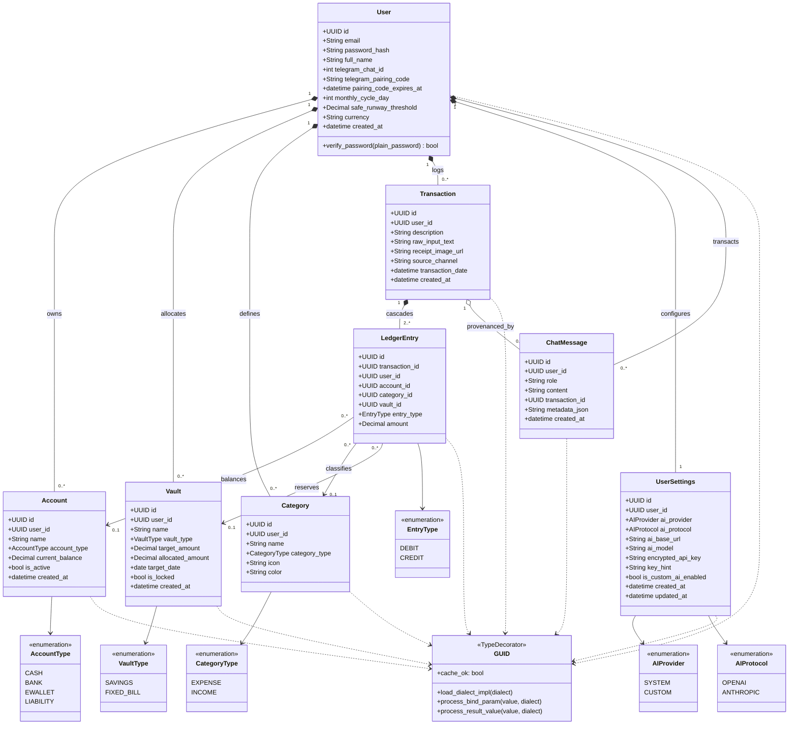

---

### 2.2 Service Layer Class Diagram

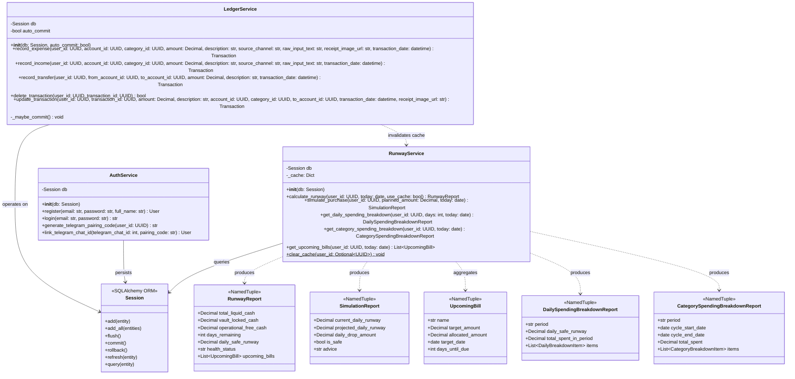

---

### 2.3 Agentic Layer Class Diagram

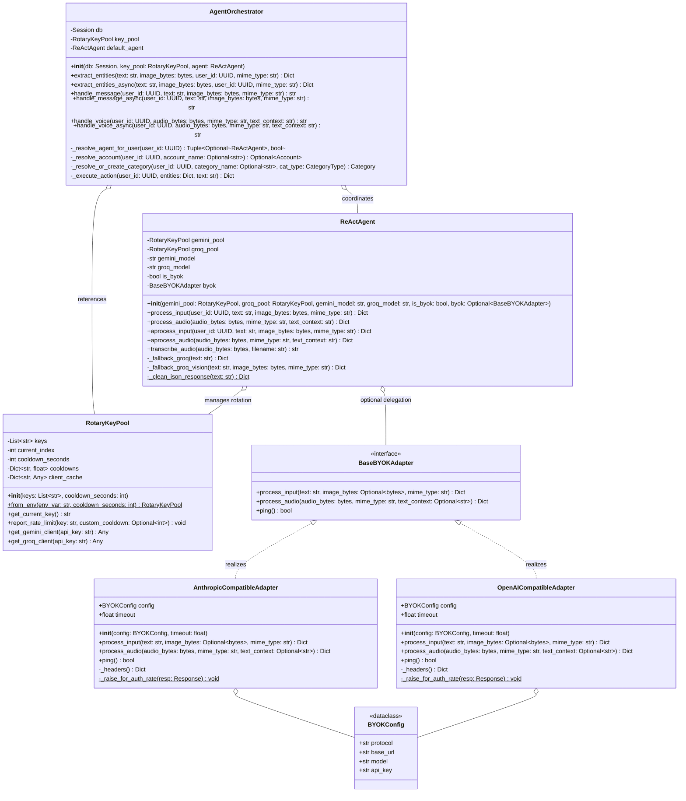

---

### 2.4 Core Infrastructure Class Diagram

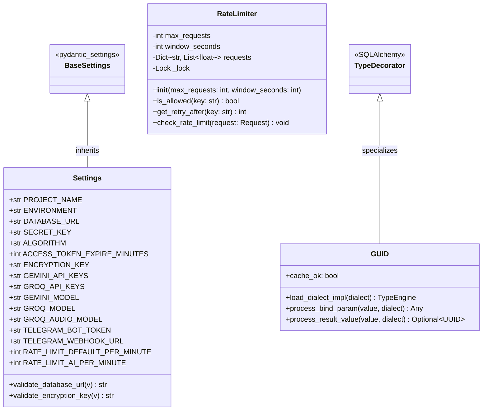

---

## Section 3: Design Pattern Catalog

### 3.1 Strategy Pattern — BYOK Protocol Adapters

- **Intent**: Provide interchangeable AI protocol implementations conforming to a unified execution contract, isolating the core orchestrator from vendor-specific payload variations (OpenAI ChatCompletions vs. Anthropic Messages API).
- **Location**: `rezekify/agent/providers/base.py`, `rezekify/agent/providers/openai_compatible.py`, `rezekify/agent/providers/anthropic_compatible.py`

#### Structural Diagram
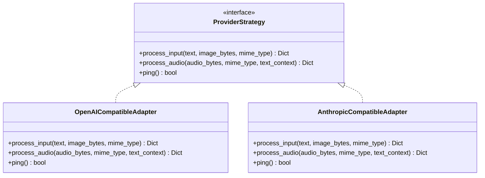

#### Key Code Contract
```python
# rezekify/agent/providers/base.py
class CapabilityUnsupported(Exception):
    """Raised when a protocol/endpoint does not support a requested modality."""

def get_adapter(config: BYOKConfig):
    """Returns the protocol adapter instance for the given config."""
    if config.protocol == "OPENAI":
        from rezekify.agent.providers.openai_compatible import OpenAICompatibleAdapter
        return OpenAICompatibleAdapter(config)
    if config.protocol == "ANTHROPIC":
        from rezekify.agent.providers.anthropic_compatible import AnthropicCompatibleAdapter
        return AnthropicCompatibleAdapter(config)
    raise ValueError(f"Protokol AI tidak dikenal: {config.protocol}")
```

---

### 3.2 Factory Method Pattern — Adapter Selection & Key Pool Construction

- **Intent**: Encapsulate object creation logic for both volatile external protocol adapters and resilient key pools initialized from delimited environment variables.
- **Location**:
  - `rezekify/agent/providers/base.py`: `get_adapter(config: BYOKConfig)`
  - `rezekify/agent/key_pool.py`: `RotaryKeyPool.from_env(env_var: str, cooldown_seconds: int)`

#### Structural Diagram
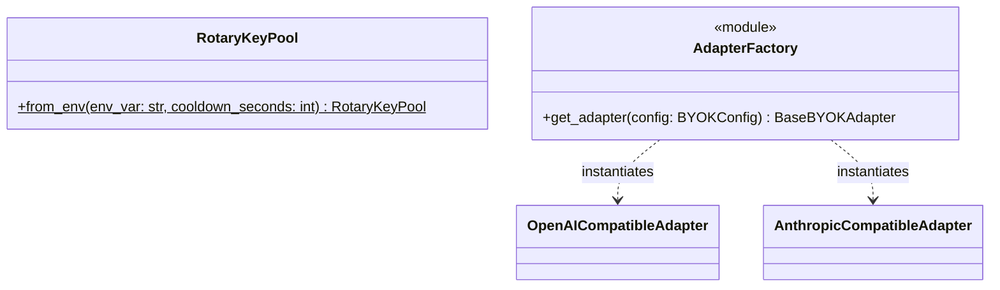

#### Key Code Contract
```python
# rezekify/agent/key_pool.py
@classmethod
def from_env(cls, env_var: str = "GEMINI_API_KEYS", cooldown_seconds: int = 60) -> "RotaryKeyPool":
    raw = os.getenv(env_var, "")
    keys = [k.strip() for k in raw.split(",") if k.strip()]
    if not keys:
        logger.warning(f"Key pool '{env_var}' kosong atau tidak diset.")
    return cls(keys=keys, cooldown_seconds=cooldown_seconds)
```

---

### 3.3 Facade Pattern — AgentOrchestrator

- **Intent**: Provide a unified, high-level interface that shields client routers from the multi-layered complexities of agent resolution, credential decryption, fuzzy entity reconciliation, double-entry ledger mutation, and real-time runway recalculation.
- **Location**: `rezekify/agent/orchestrator.py:AgentOrchestrator`

#### Structural Diagram
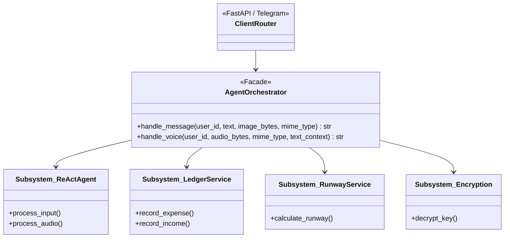

#### Key Code Contract
```python
# rezekify/agent/orchestrator.py
def handle_message(self, user_id: UUID, text: str, image_bytes: Optional[bytes] = None, mime_type: str = "image/jpeg") -> str:
    agent, is_byok = self._resolve_agent_for_user(user_id)
    if is_byok and agent is None:
        return "Pengaturan AI kustom Anda belum lengkap atau kunci API tidak valid."
    
    entities = self.extract_entities(text, image_bytes, user_id=user_id, mime_type=mime_type)
    action_result = self._execute_action(user_id, entities, text)
    return action_result["reply"]
```

---

### 3.4 Template Method Pattern — LedgerService Record Operations

- **Intent**: Enforce an invariant sequence for recording transactions (validation -> pessimistic lock acquisition -> transaction envelope creation -> balanced ledger pair emission -> balance adjustment -> flush -> conditional commit -> cache invalidation), delegating only specific accounting legs.
- **Location**: `rezekify/services/ledger.py:LedgerService`

#### Structural Diagram
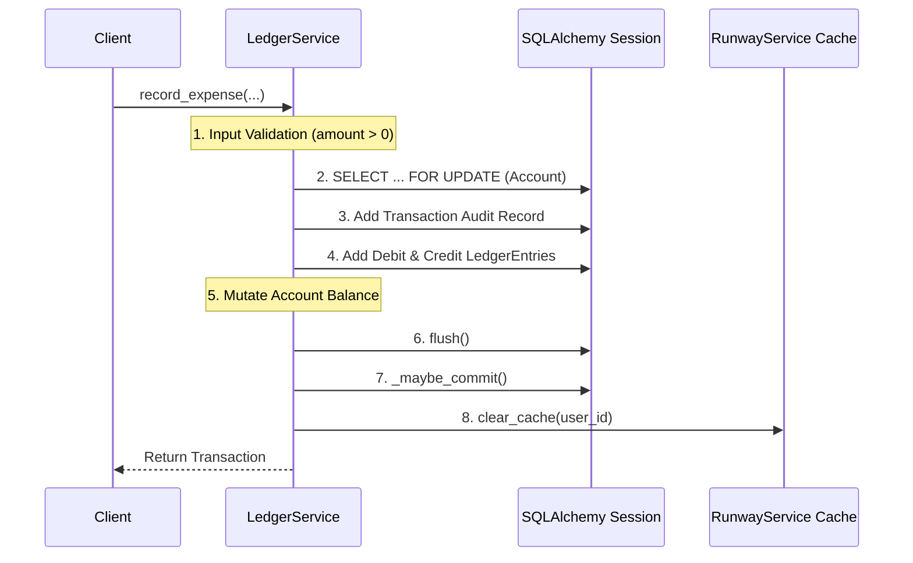

#### Key Code Contract
```python
# rezekify/services/ledger.py
def _maybe_commit(self) -> None:
    """Helper to commit only when auto_commit=True.
    
    Enables composition inside larger units of work.
    """
    if self.auto_commit:
        self.db.commit()

def record_expense(self, user_id: UUID, account_id: UUID, category_id: Optional[UUID], amount: Decimal, ...) -> Transaction:
    if amount <= Decimal("0"):
        raise ValueError("Jumlah transaksi harus lebih besar dari 0.")
    
    account = self.db.query(Account).filter_by(id=account_id, user_id=user_id).with_for_update().first()
    if not account:
        raise ValueError("Akun tidak ditemukan.")

    tx = Transaction(user_id=user_id, description=description, ...)
    self.db.add(tx)
    self.db.flush()

    debit_entry = LedgerEntry(transaction_id=tx.id, user_id=user_id, category_id=category_id, entry_type=EntryType.DEBIT, amount=amount)
    credit_entry = LedgerEntry(transaction_id=tx.id, user_id=user_id, account_id=account.id, entry_type=EntryType.CREDIT, amount=amount)
    self.db.add_all([debit_entry, credit_entry])
    account.current_balance -= amount
    
    self.db.flush()
    self._maybe_commit()
    RunwayService.clear_cache(user_id=user_id)
    return tx
```

---

### 3.5 Chain of Responsibility — ReActAgent Failover Chain

- **Intent**: Provide resilience against provider rate limits, network timeouts, and model unavailability by chaining multiple execution handlers across tiers and modalities.
- **Location**: `rezekify/agent/runtime.py:ReActAgent`

#### Structural Diagram
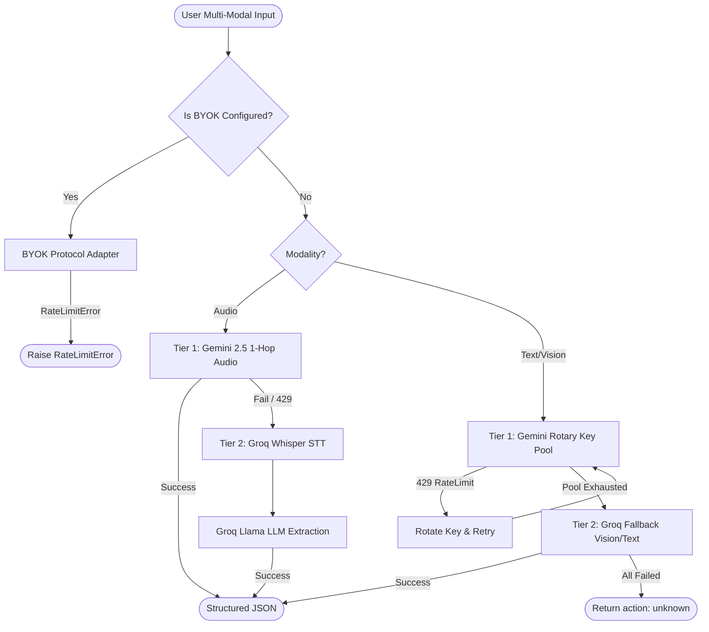

#### Key Code Contract
```python
# rezekify/agent/runtime.py
def process_input(self, user_id: Optional[UUID], text: str, image_bytes: Optional[bytes] = None, mime_type: str = "image/jpeg") -> Dict[str, Any]:
    if self.is_byok and self.byok:
        return self._byok_process_input(text, image_bytes, mime_type)

    # Tier 1: Gemini Key Pool with rotational retry
    for _ in range(max(1, len(self.gemini_pool.keys))):
        key = self.gemini_pool.get_current_key()
        try:
            client = self.gemini_pool.get_gemini_client(key)
            response = client.models.generate_content(...)
            return self._clean_json_response(response.text)
        except Exception as e:
            if "429" in str(e) or "RESOURCE_EXHAUSTED" in str(e):
                self.gemini_pool.report_rate_limit(key)
                continue
            break

    # Tier 2: Groq Fallback
    try:
        if image_bytes:
            return self._fallback_groq_vision(text, image_bytes, mime_type)
        return self._fallback_groq(text)
    except Exception:
        return {"action": "unknown", "raw": text}
```

---

### 3.6 Observer Pattern — Runway Cache Invalidation

- **Intent**: Decouple the financial transaction pipeline from analytical caching concerns by triggering cache evictions whenever balance mutations occur.
- **Location**: `rezekify/services/ledger.py` notifying `rezekify/services/runway.py`

#### Structural Diagram
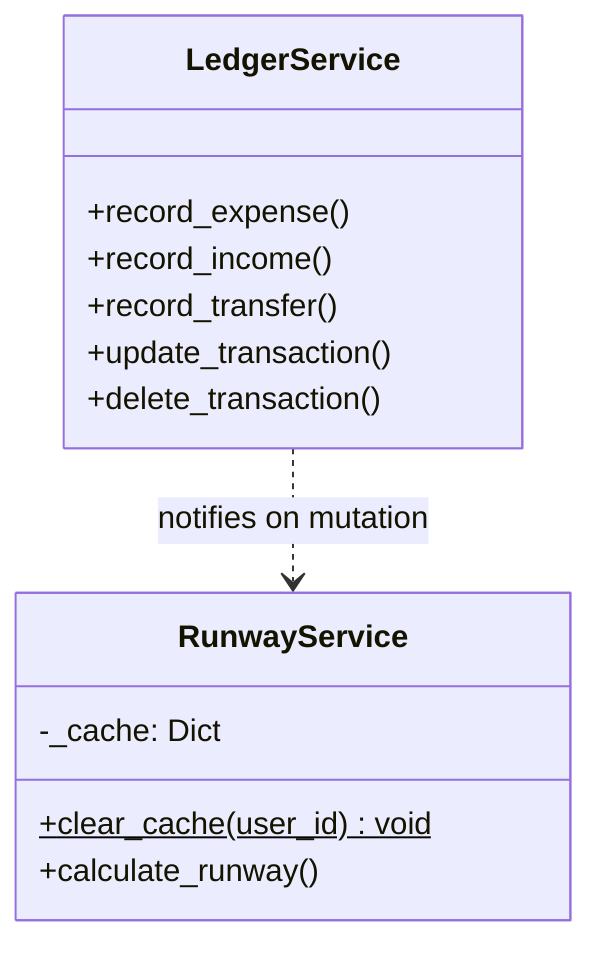

#### Key Code Contract
```python
# rezekify/services/runway.py
_cache: Dict[Tuple[UUID, date], Tuple[float, RunwayReport]] = {}

@classmethod
def clear_cache(cls, user_id: Optional[UUID] = None) -> None:
    """Invalidates runway cache. If user_id given, clears only that user's entries."""
    if user_id is None:
        cls._cache.clear()
    else:
        keys_to_del = [k for k in cls._cache if k[0] == user_id]
        for k in keys_to_del:
            cls._cache.pop(k, None)
```

---

### 3.7 Singleton Pattern — Application-Level Key Pool

- **Intent**: Maintain global state across independent HTTP requests and worker threads for API key rotation indexes and dynamic rate-limit cooldown timestamps.
- **Location**: `rezekify/api/deps.py:get_gemini_key_pool`

#### Structural Diagram
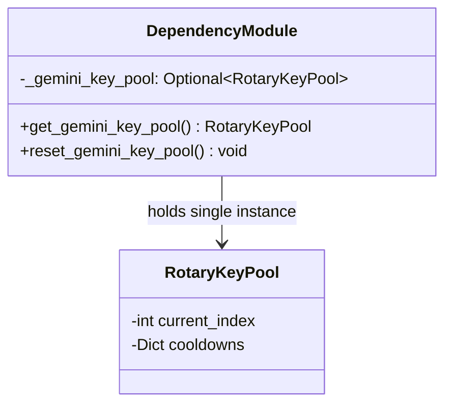

#### Key Code Contract
```python
# rezekify/api/deps.py
_gemini_key_pool: Optional[RotaryKeyPool] = None

def get_gemini_key_pool() -> RotaryKeyPool:
    """Returns application-level singleton RotaryKeyPool for Gemini API keys.
    
    Preserves key rotation state and rate-limit cooldown across requests.
    """
    global _gemini_key_pool
    if _gemini_key_pool is None:
        _gemini_key_pool = RotaryKeyPool.from_env("GEMINI_API_KEYS")
    return _gemini_key_pool
```

---

## Section 4: Defensive Typing, Invariants & Exception Hierarchy

### 4.1 Exception Class Hierarchy

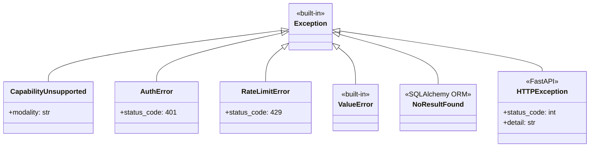

#### Exception Semantics & Failure Boundaries
1. **`CapabilityUnsupported`**: Raised by protocol adapters when an endpoint cannot process a requested modality (e.g., Anthropic Messages API invoked for direct binary audio transcription). Handled by orchestrator to return user-friendly advice.
2. **`AuthError`**: Triggered when a BYOK endpoint rejects credentials with HTTP 401. Trapped at the orchestrator boundary to advise the user to re-verify settings.
3. **`RateLimitError`**: Triggered when upstream BYOK endpoints return HTTP 429. Signals exhaustion of user-provided quotas.
4. **`ValueError`**: Raised within service domains on constraint violations (e.g., non-positive amounts, identical transfer accounts, malformed cycle dates).
5. **`NoResultFound` / `HTTPException`**: Managed at the API routing boundary to emit structured RFC 7807 compliant error responses.

---

### 4.2 Input Validation & Sanitization Boundaries

Every entry point to the system applies strict type assertions, range validation, and input sanitization:

| Boundary / Parameter | Validation Rule & Constraints | Enforcement Location | Failure Outcome |
| :--- | :--- | :--- | :--- |
| **Transaction Amount** | Must be strictly positive: $\text{amount} > 0$, quantized to two decimal places (`Decimal('0.01')`). | `LedgerService.record_*()`, `TransactionCreateRequest` | `ValueError("Jumlah transaksi harus lebih besar dari 0.")` |
| **Account Transfer** | Source account must differ from destination account: `from_account_id != to_account_id`. | `LedgerService.record_transfer()` | `ValueError("Akun asal dan tujuan tidak boleh sama.")` |
| **User Password** | Length bounded between 8 and 72 characters; bcrypt 72-byte truncation enforced. | `RegisterRequest`, `hash_password()` | `422 Unprocessable Entity` |
| **User Email** | RFC 5322 email syntax validation via Pydantic `EmailStr`. | `RegisterRequest` | `422 Unprocessable Entity` |
| **Receipt Image Upload** | MIME type in `image/jpeg, image/png, image/webp`, magic byte verification, max size 10MB. | `dashboard_router.ai_receipt_upload()` | `HTTPException(400, "Format file tidak didukung / ukuran melebihi batas")` |
| **Voice Audio Upload** | MIME type in `audio/ogg, audio/mpeg, audio/wav, audio/x-m4a, audio/mp4`, max size 10MB. | `dashboard_router.ai_voice_endpoint()` | `HTTPException(400, "Format audio tidak didukung")` |
| **BYOK Base URL** | Must use `https://` scheme, host required, loopback/private/link-local/multicast IP literals blocked. Resolve check at request time. | `validate_base_url()` in `base.py` | `ValueError("base_url menunjuk ke alamat privat/loopback...")` |
| **Account/Category Names** | Strips SQL wildcards (`%`, `_`) and truncates leading/trailing whitespace. | `AgentOrchestrator._resolve_or_create_category()` | Sanitized string passed to ILIKE queries |
| **Monthly Cycle Day** | Integer range restricted to $1 \le \text{cycle\_day} \le 31$. | `UserProfileUpdateRequest` | `422 Unprocessable Entity` |
| **Safe Runway Threshold** | Non-negative numeric value: $\text{threshold} \ge 0$. | `UserProfileUpdateRequest` | `422 Unprocessable Entity` |

---

### 4.3 System Invariants

The Rezekify domain guarantees six fundamental architectural invariants across all transactions:

```
┌────────────────────────────────────────────────────────────────────────────────────────────────────────┐
│                                   REZEKIFY ARCHITECTURAL INVARIANTS                                    │
├─────┬──────────────────────┬───────────────────────────────────────────┬───────────────────────────────┤
│ No. │ Invariant Principle  │ Technical Enforcement Mechanism           │ Violation Response            │
├─────┼──────────────────────┼───────────────────────────────────────────┼───────────────────────────────┤
│ 1   │ Balanced Ledger      │ Every recorded transaction generates      │ Transaction rollbacks via DB  │
│     │                      │ exactly one DEBIT and one CREDIT          │ exception; `ValueError` on    │
│     │                      │ `LedgerEntry` with identical amounts.     │ asymmetric legs.              │
├─────┼──────────────────────┼───────────────────────────────────────────┼───────────────────────────────┤
│ 2   │ Tenant Isolation     │ Every query and balance mutation mandates │ Empty query set returned or   │
│     │                      │ explicit `filter_by(user_id=...)` or      │ `HTTPException(404)` raised.  │
│     │                      │ `filter(Model.user_id == current_user)`.  │ Cross-tenant leaks blocked.   │
├─────┼──────────────────────┼───────────────────────────────────────────┼───────────────────────────────┤
│ 3   │ Deterministic Math   │ Floating-point arithmetic is forbidden.   │ Type system compile check;    │
│     │                      │ All calculations use `decimal.Decimal` and │ runtime conversion to         │
│     │                      │ SQL `Numeric(15,2)` columns.              │ `Decimal` on bind.            │
├─────┼──────────────────────┼───────────────────────────────────────────┼───────────────────────────────┤
│ 4   │ Positive Amounts     │ Zero or negative transaction values are   │ Immediate guard rejection     │
│     │                      │ rejected prior to account locks or state  │ raising `ValueError`.         │
│     │                      │ mutations.                                │                               │
├─────┼──────────────────────┼───────────────────────────────────────────┼───────────────────────────────┤
│ 5   │ Deadlock Prevention  │ Inter-account transfers lock rows in      │ Deadlock impossible by        │
│     │ (Ordered Locks)      │ deterministic order:                      │ consistent global lock        │
│     │                      │ `min(from_id, to_id)` acquired first.     │ acquisition hierarchy.        │
├─────┼──────────────────────┼───────────────────────────────────────────┼───────────────────────────────┤
│ 6   │ Vault Lock Defense   │ Vaults marked `is_locked = True` block    │ API raises `HTTPException(400)`│
│     │                      │ deletion and disallow allocation decreases│ preventing premature capital  │
│     │                      │ before their target date expires.         │ liquidation.                  │
└─────┴──────────────────────┴───────────────────────────────────────────┴───────────────────────────────┘
```

#### Detailed Invariant Code Verifications

##### Invariant 1: Balanced Ledger
```python
# Enforced in rezekify/services/ledger.py
debit_entry = LedgerEntry(
    transaction_id=tx.id,
    user_id=user_id,
    category_id=category_id,
    entry_type=EntryType.DEBIT,
    amount=amount,
)
credit_entry = LedgerEntry(
    transaction_id=tx.id,
    user_id=user_id,
    account_id=account.id,
    entry_type=EntryType.CREDIT,
    amount=amount,
)
self.db.add_all([debit_entry, credit_entry])
```

##### Invariant 5: Ordered Lock Acquisition for Deadlock Avoidance
```python
# Enforced in rezekify/services/ledger.py:record_transfer
first_id, second_id = (
    (from_account_id, to_account_id)
    if from_account_id < to_account_id
    else (to_account_id, from_account_id)
)

first_acc = self.db.query(Account).filter_by(id=first_id, user_id=user_id).with_for_update().first()
second_acc = self.db.query(Account).filter_by(id=second_id, user_id=user_id).with_for_update().first()
```

##### Invariant 6: Vault Lock Protection
```python
# Enforced in rezekify/api/v1/vaults.py
if vault.is_locked:
    if update_data.allocated_amount is not None and update_data.allocated_amount < vault.allocated_amount:
        raise HTTPException(
            status_code=status.HTTP_400_BAD_REQUEST,
            detail="Tidak dapat mengurangi alokasi dana pada brankas terkunci."
        )
```

---

*This specification serves as the authoritative object-oriented architectural contract for the Rezekify platform. All implementations and extensions must preserve these patterns, structural contracts, and invariants.*
