# Rezekify — Dynamic Interaction Flows & Sequence Specifications

**Document ID:** ARCH-004 | **Version:** 1.0.0 | **Framework:** Concurrency Models, Sequence Diagrams & FSM  
**Target Environment:** Docker Compose (PostgreSQL 16 + FastAPI + Nginx) | **Status:** Active  

---

## Section 1: Master Dynamic Architecture Overview

### 1.1 Ingress-to-Egress Bus Topology

Rezekify handles multi-modal ingress traffic from two primary entry points: web clients operating a single-page React 18 interface, and automated webhooks dispatched by the Telegram Bot API platform. Ingress, mediation, persistence, and external model egress are structured according to the topology below:

```
                        ┌─────────────────────────────────────────────────────────────┐
  End User (SPA) ──HTTPS──► │ Nginx :80 (Container: rezekify-nginx)                     │
  [Browser Fetch / SPA] │   ├─ Static Assets (/usr/share/nginx/html)                  │
                        │   └─ /api/v1/* ──reverse proxy──►                           │
                        │                                                             │
  Telegram API ──POST──► │ Uvicorn :8000 (2 workers, asyncio, rezekify-backend)       │
  [/gateway/telegram]   │   ├─ Async Handlers (FastAPI Event Loop)                    │
                        │   │   ├─ POST /dashboard/ai-chat                            │
                        │   │   ├─ POST /dashboard/ai-receipt                         │
                        │   │   └─ POST /dashboard/ai-voice                           │
                        │   │        │                                                │
                        │   │        └──httpx.AsyncClient (timeout=20.0s)──►          │
                        │   │             ├─ Google Gemini 2.5 Flash REST API         │
                        │   │             ├─ Groq Whisper & Llama Vision REST API     │
                        │   │             └─ User Custom BYOK Endpoint (SSRF Guarded) │
                        │   │                                                         │
                        │   ├─ Sync Handlers (FastAPI Threadpool Worker Threads)      │
                        │   │   ├─ POST /gateway/telegram (Telegram webhook)          │
                        │   │   │    └──google-genai SDK / groq SDK (Blocking)        │
                        │   │   ├─ CRUD (/accounts, /vaults, /transactions, /auth)    │
                        │   │   └─ In-Memory State (Process-Local RAM):               │
                        │   │        ├─ _runway_cache (TTL 15s, Max 5000)             │
                        │   │        ├─ RateLimiter._history (Deques, Max 5000)       │
                        │   │        ├─ _processed_update_ids (Dedup, Max 10000)      │
                        │   │        ├─ TelegramGateway.failed_pairing_attempts       │
                        │   │        └─ RotaryKeyPool.cooldowns (Epoch Timestamps)    │
                        │   │                                                         │
                        │   └─ SQLAlchemy Session (psycopg2 sync driver) ──►          │
                        │        pool_size=3, max_overflow=2, pool_recycle=1800s     │
                        │        pool_pre_ping=True, pool_timeout=10s                 │
                        │                                                             │
                        │ PostgreSQL 16 :5432 (Container: rezekify-db)               │
                        │   max_connections=30 (Dedicated Storage Engine)             │
                        └─────────────────────────────────────────────────────────────┘
```

### 1.2 Synchronous vs Asynchronous Message Boundaries

The system intentionally segregates operations across asynchronous non-blocking event loops, synchronous threadpools, and transactional database boundaries to maximize throughput while guaranteeing absolute double-entry accounting integrity.

| Boundary | Sync / Async | Underlying Mechanism | Timeout / Limits | Purpose & Fail-Safe Invariants |
| :--- | :--- | :--- | :--- | :--- |
| **Browser SPA → Nginx** | Async | HTTP/1.1 over TCP / TLS | Keep-Alive 65s | Static React bundle delivery and reverse proxy ingress forwarding. |
| **Nginx → Uvicorn** | Async | HTTP reverse proxy pass | `proxy_read_timeout 90s` | Buffers incoming client uploads; supports long-running multi-modal inference. |
| **Browser → apiClient** | Async | Fetch API (`AbortController`) | Default: 90s, Refresh: 15s | Protects client UI against hanging network states; aborts stale telemetry. |
| **Route Handler → Database** | Sync | SQLAlchemy `SessionLocal` via `psycopg2` | `pool_timeout=10s`, `statement_timeout` | Executes in threadpool; strict row locking via `with_for_update()`. |
| **Async Routes → Gemini / Groq** | Async | `httpx.AsyncClient` | `timeout=20.0s` | Non-blocking LLM/Vision/STT requests without stalling Uvicorn event loop. |
| **Sync Routes → Gemini / Groq** | Sync | `google-genai` / `groq` SDK | SDK Network Default | Runs inside threadpool for Telegram webhook processing. |
| **FastAPI Startup → PostgreSQL** | Sync | `sqlalchemy.engine.connect()` retry loop | 30 attempts × 2.0s delay | Prevents application crash loops during Docker container orchestration boot. |
| **Frontend Token Refresh** | Async | Singleton Promise Pattern | `timeout=15.0s` | De-duplicates concurrent 401 token refresh requests into a single flight. |

---

## Section 2: Exhaustive Sequence Diagrams

### SD-01: User Registration & First Login

This sequence captures full user onboarding: form submission, input validation, bcrypt password hashing, double token emission (short-lived access token and HttpOnly refresh cookie), and redirection to the application dashboard.

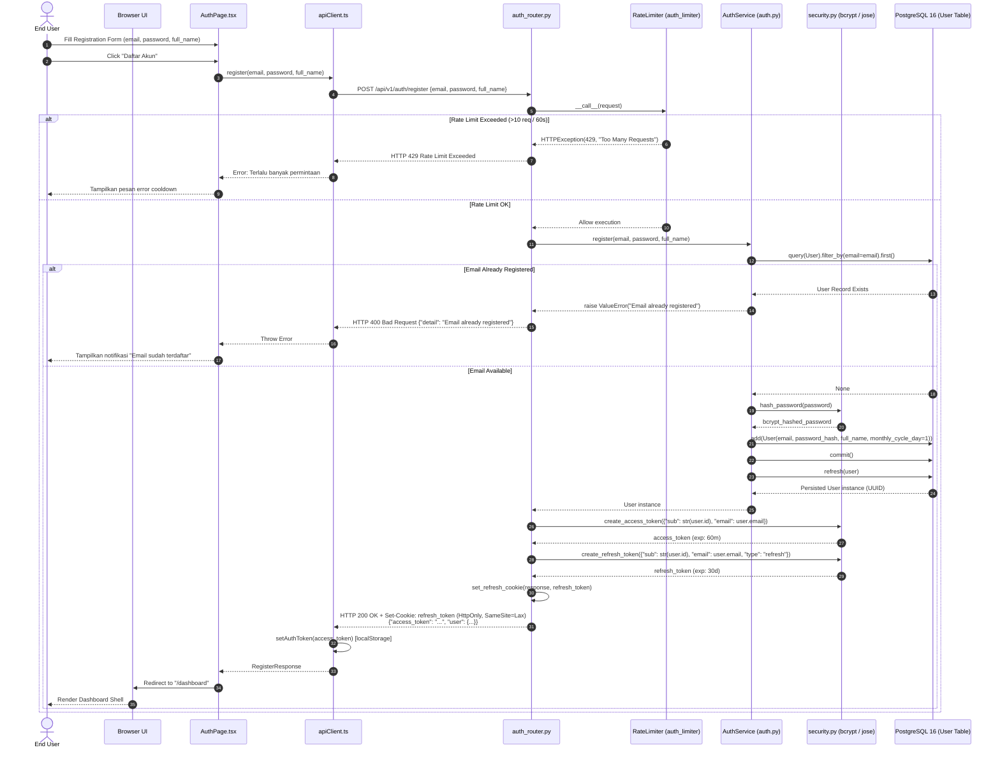

---

### SD-02: AI Chat Text to Ledger Mutation (Happy Path)

This sequence illustrates the conversion of Indonesian conversational text into a double-entry ledger mutation, followed by deterministic runway recalculation and chat history enrichment.

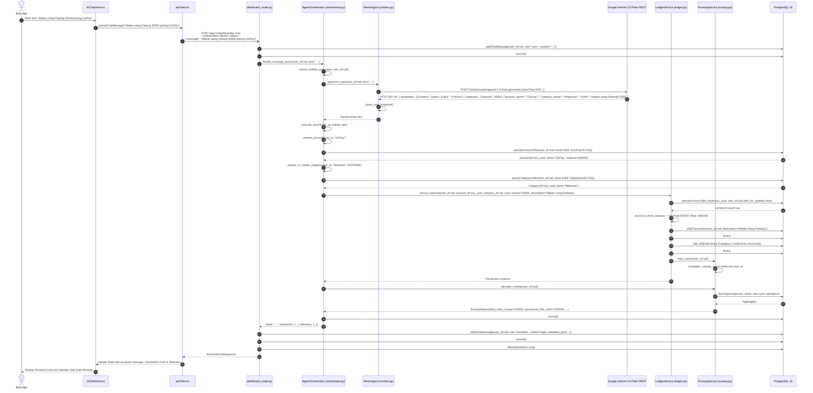

---

### SD-03: Receipt Image OCR with Groq Vision Fallback

This sequence details the execution path when an uploaded shopping receipt encounters a rate limit (HTTP 429) on the primary Gemini rotary key pool and automatically fails over to the Groq Vision multi-modal adapter.

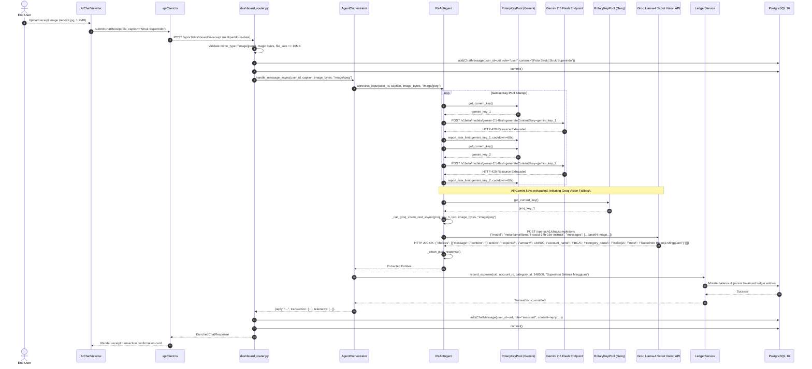

---

### SD-04: Voice Note with 2-Hop Fallback

This sequence demonstrates voice processing when the 1-Hop direct Gemini audio multimodal pipeline fails, triggering the 2-Hop fallback: Groq Whisper transcription followed by Groq Llama extraction.

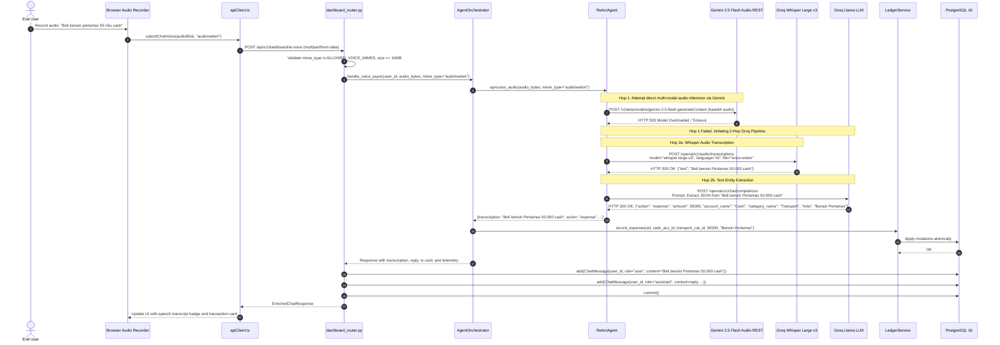

---

### SD-05: JWT Token Refresh Flow

This sequence models how client requests encountering an expired access token (`HTTP 401`) coordinate through a singleton promise (`refreshPromise`) to prevent race conditions during refresh token rotation.

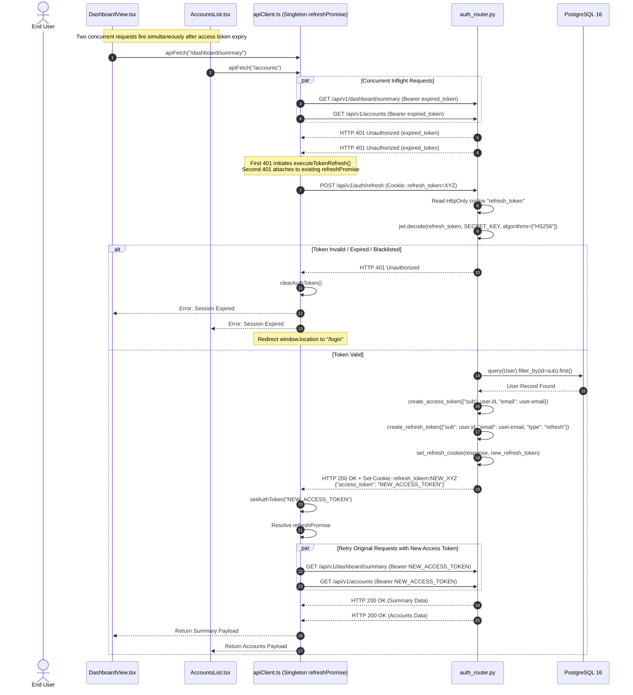

---

### SD-06: Telegram Bot Pairing & First Message

This sequence displays the Telegram onboarding flow: pairing code generation in the Web SPA, pairing command dispatch via Telegram webhook, brute-force rate limit evaluation, account linking, and subsequent financial message execution.

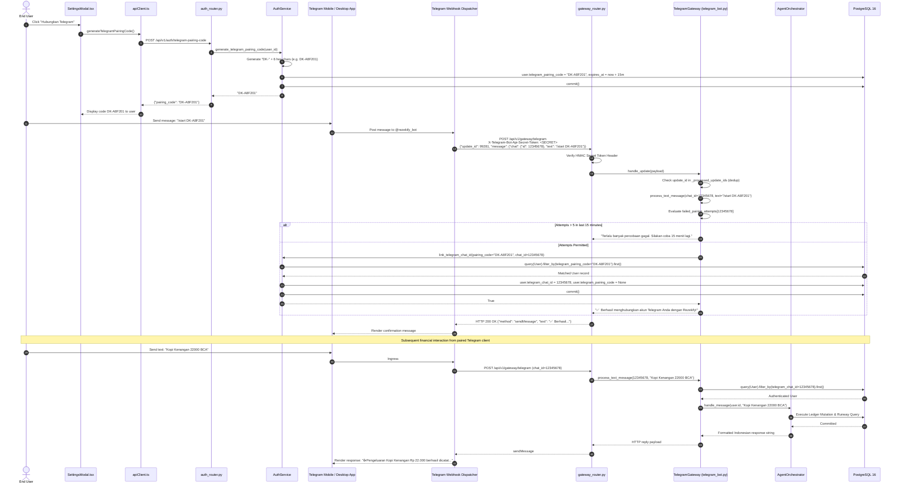

---

### SD-07: Transaction Update (Reversal-and-Repost)

This sequence details the `reversal-and-repost` accounting pattern inside `LedgerService.update_transaction()`, showing row-level locking, balance restoration, validation of new targets, mutation, and cache purging.

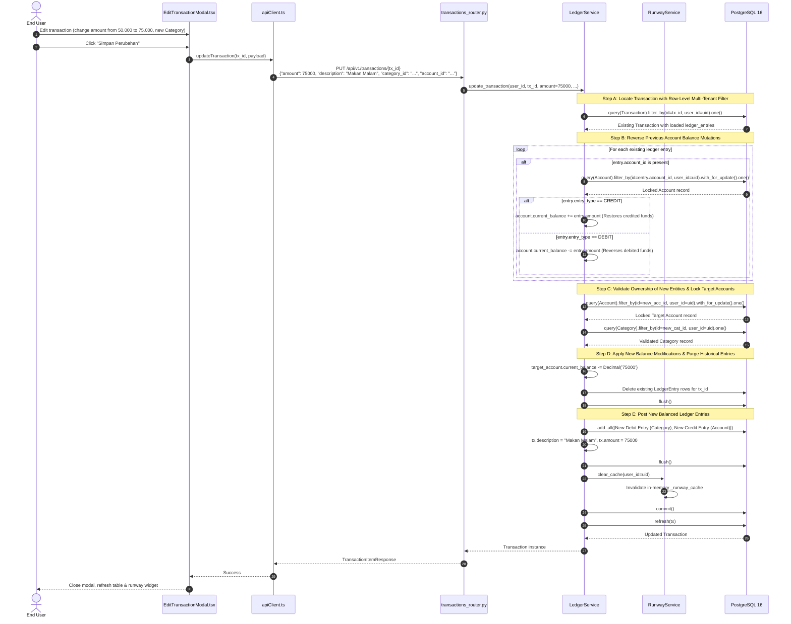

---

### SD-08: BYOK Configuration & Validation

This sequence models the Bring-Your-Own-Key configuration workflow, including strict Server-Side Request Forgery (SSRF) hostname and IP validation, live endpoint pinging, and PBKDF2 Fernet encryption at rest.

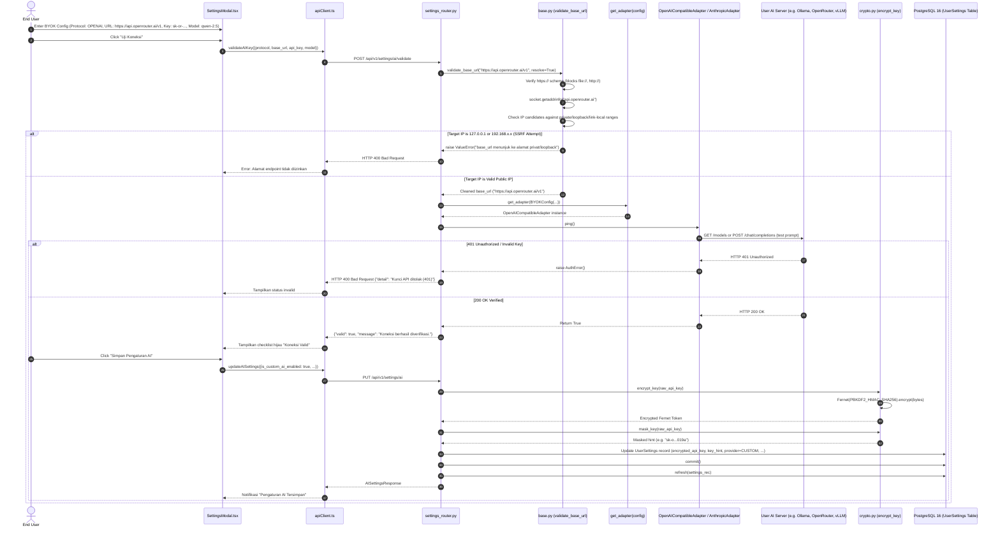

---

## Section 3: Finite State Machine (FSM) Specifications

### FSM-01: Transaction Lifecycle

A Rezekify transaction transitions from creation through balanced active state, update reconciliations, and terminal deletion. Balanced double-entry parity is maintained at every resting phase.

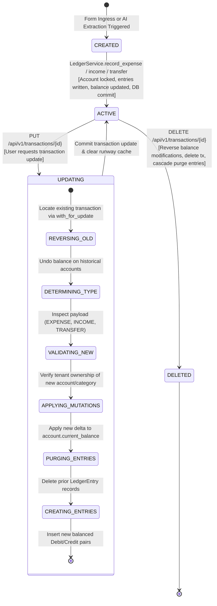

---

### FSM-02: Vault Lock Lifecycle

The Vault lock state machine protects financial commitments from accidental depletion. When locked, funds cannot be decreased or deleted without an explicit administrative unlock action.

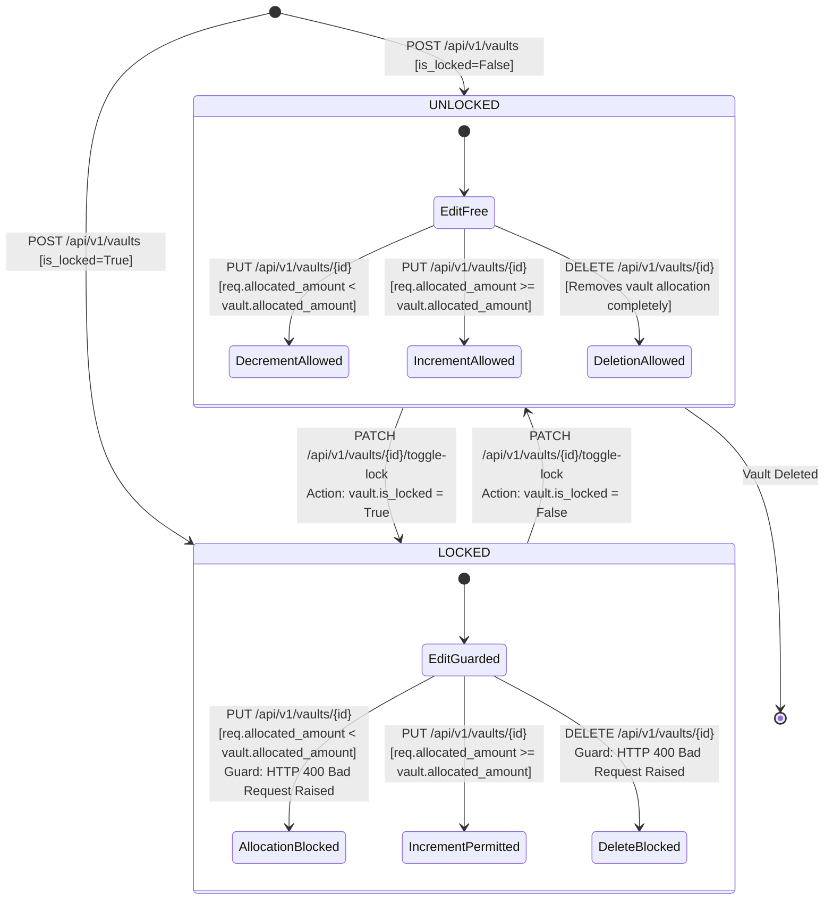

---

### FSM-03: User Authentication Lifecycle

This state machine tracks the lifecycle of user authentication across token issuance, active authorized operations, expiration, and session termination.

```mermaid
stateDiagram-v2
    [*] --> ANONYMOUS: Client initiates session / visits website

    ANONYMOUS --> REGISTERING: POST /api/v1/auth/register
    REGISTERING --> ANONYMOUS: Registration validation error (HTTP 400)
    REGISTERING --> AUTHENTICATED: Hash password + issue access_token + set HttpOnly refresh_token

    ANONYMOUS --> AUTHENTICATED: POST /api/v1/auth/login<br/>[Valid credentials verified]

    state AUTHENTICATED {
        [*] --> ACTIVE_TOKEN: access_token stored in memory / localStorage
        ACTIVE_TOKEN --> EXECUTING_REQUESTS: apiFetch with Authorization: Bearer
        EXECUTING_REQUESTS --> ACTIVE_TOKEN: HTTP 200 OK
    }

    AUTHENTICATED --> TOKEN_EXPIRED: Access token lifetime elapsed (60 minutes)

    state TOKEN_EXPIRED {
        [*] --> AWAITING_REFRESH: apiFetch receives HTTP 401 Unauthorized
        AWAITING_REFRESH --> REFRESHING: executeTokenRefresh() fires
        REFRESHING --> TOKEN_EXPIRED: Concurrent 401s attach to existing refreshPromise
    }

    TOKEN_EXPIRED --> AUTHENTICATED: POST /api/v1/auth/refresh returns new access_token + rotated cookie
    TOKEN_EXPIRED --> LOGGED_OUT: Refresh token invalid / expired / missing (HTTP 401)

    AUTHENTICATED --> TELEGRAM_PAIRED: POST /auth/telegram-pairing-code + bot /start command verified
    TELEGRAM_PAIRED --> AUTHENTICATED: POST /settings/telegram/unlink

    AUTHENTICATED --> LOGGED_OUT: POST /api/v1/auth/logout<br/>Action: clearAuthToken() + clear_refresh_cookie()
    LOGGED_OUT --> ANONYMOUS: Redirection to /login
```

---

### FSM-04: ReActAgent Failover Chain (Text & Vision)

This state machine specifies the multi-tier failover mechanics executed during entity extraction across rotary pools and provider adapters.

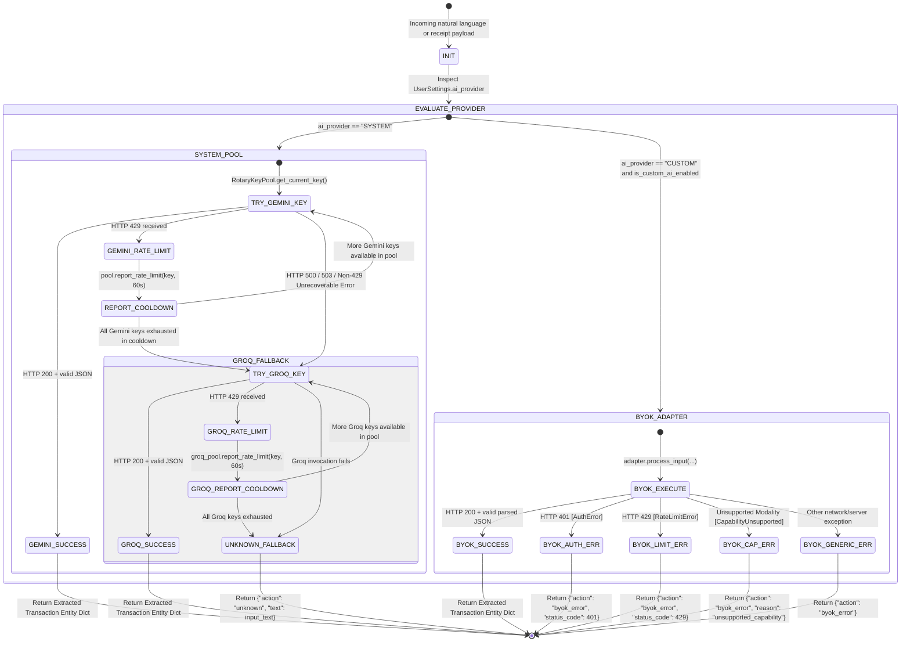

---

### FSM-05: Runway Cache Lifecycle

The deterministic runway engine optimizes read performance through an in-memory TTL cache with lazy sweep amortization.

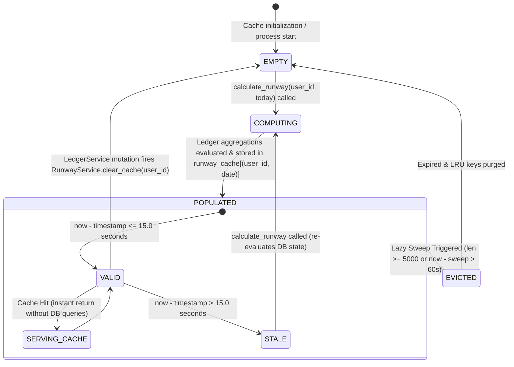

---

### FSM-06: Rate Limiter Key Lifecycle

The rate limiter tracks caller identities (authenticated user UUID or remote IP) inside sliding window timestamp deques.

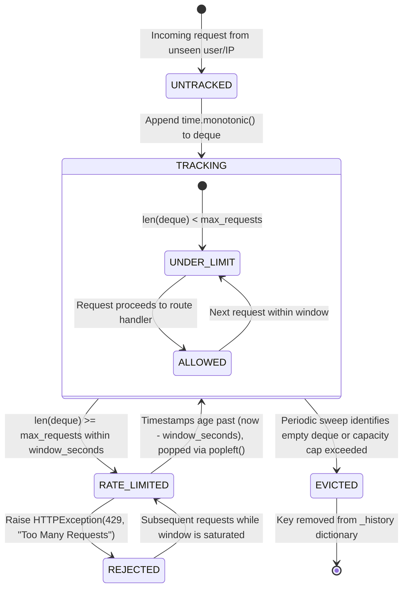

---

## Section 4: Concurrency, Contention & Deadlock Avoidance

### 4.1 Database Row-Level Locking Strategy

High-frequency concurrent balance mutations—such as simultaneous webhook messages and web dashboard actions—can induce database deadlocks if accounts are locked in arbitrary sequences. To guarantee deadlock-free execution, Rezekify enforces **Strict Global Lock Ordering** across all multi-account mutations.

In `LedgerService.record_transfer()`, account identifiers are sorted lexicographically before row-level locks are acquired:

```python
# rezekify/services/ledger.py - Deadlock-free ordered lock acquisition
first_id, second_id = (
    (from_account_id, to_account_id)
    if from_account_id < to_account_id
    else (to_account_id, from_account_id)
)

acc1 = (
    self.db.query(Account)
    .filter_by(id=first_id, user_id=user_id)
    .with_for_update()
    .one()
)
acc2 = (
    self.db.query(Account)
    .filter_by(id=second_id, user_id=user_id)
    .with_for_update()
    .one()
)
```

**Deadlock Avoidance Proof**:
1. Suppose Transaction $T_1$ transfers funds from Account $A$ to Account $B$ ($A < B$).
2. Concurrently, Transaction $T_2$ transfers funds from Account $B$ to Account $A$ ($B > A$).
3. Under unsorted locking, $T_1$ acquires Lock($A$) and waits for Lock($B$), while $T_2$ acquires Lock($B$) and waits for Lock($A$), creating a circular wait condition (deadlock).
4. By sorting IDs such that $A < B$, both $T_1$ and $T_2$ are required to acquire Lock($A$) before requesting Lock($B$). $T_2$ blocks on Lock($A$) until $T_1$ completes its commit, converting an unsafe circular wait into a serialized queue.

In `LedgerService.update_transaction()`, a two-phase ordered locking model is applied:
- **Phase 1 (Reversal)**: Accounts associated with old ledger entries are locked with `with_for_update()` to restore historical balances.
- **Phase 2 (Re-post)**: Accounts associated with new entries are validated and locked in sorted ID order prior to applying updated balance debits/credits.

---

### 4.2 Connection Pool Contention

Database connection resources are strictly budgeted to prevent pool exhaustion and thread starvation:

```
┌────────────────────────────────────────────────────────────────────────┐
│                        CONNECTION POOL BUDGET                          │
├──────────────────────────┬─────────────────────────────────────────────┤
│ Uvicorn Worker Count     │ 2 workers (WEB_CONCURRENCY=2)               │
│ Pool Size per Worker     │ pool_size=3                                 │
│ Max Overflow per Worker  │ max_overflow=2                              │
│ Peak Conns per Worker    │ 3 + 2 = 5 concurrent connections            │
│ Global App Peak Conns    │ 2 workers × 5 = 10 connections              │
│ PostgreSQL Server Cap    │ max_connections=30                          │
│ Safety Headroom          │ 20 unused connections (Admin / Migrations)  │
└──────────────────────────┴─────────────────────────────────────────────┘
```

**Resilience Parameters**:
- `pool_pre_ping=True`: Tests connections for liveness using `SELECT 1` prior to checkout, transparently discarding connections dropped by the database or intermediate firewalls.
- `pool_recycle=1800`: Recycles connections after 30 minutes, mitigating silent TCP connection drops on cloud container networks.
- `pool_timeout=10`: If all 5 connections in a worker pool are saturated, subsequent checkout requests block for at most 10 seconds before raising `TimeoutError`, preventing indefinite client hanging.

---

### 4.3 In-Memory Cache Thread Safety

Rezekify employs module-level dictionaries for high-speed ephemeral state:
1. `_runway_cache`: Stores precomputed `RunwayReport` tuples keyed by `(user_id, date)`.
2. `RateLimiter._history`: Stores sliding-window `deque[float]` timestamps keyed by user/IP.
3. `_processed_update_ids`: Deduplicates Telegram webhook deliveries keyed by `update_id`.
4. `TelegramGateway.failed_pairing_attempts`: Tracks brute-force pairing attempts.
5. `RotaryKeyPool.cooldowns`: Stores per-key cooldown expiration epochs.

**Thread Safety Analysis (CPython GIL & Multi-Worker Architecture)**:
- **Process Isolation**: Each Uvicorn worker process maintains its own independent memory space. No cache state is shared across process boundaries without explicit serialization.
- **GIL Atomic Operations**: In CPython 3.12, dictionary lookups (`dict.get`), assignments (`dict[k] = v`), deletions (`dict.pop`), and deque mutations (`deque.append`, `deque.popleft`) are atomic bytecode instructions (`BINARY_SUBSCR`, `STORE_SUBSCR`, `DELETE_SUBSCR`).
- **ponytail**: Current dictionary and deque structures are thread-safe under CPython's Global Interpreter Lock for single-node deployments; upgrade to Redis with centralized key expiration when scaling horizontally across multi-node clusters.

---

### 4.4 Singleton Token Refresh Race Prevention

When a user's access token expires, multiple asynchronous components on the web dashboard (e.g., summary widgets, account lists, transaction tables) may fire concurrent requests simultaneously. If each request handled 401 independently, multiple parallel `/auth/refresh` requests would hit the server, leading to race conditions where one request invalidates the refresh cookie of another.

Rezekify solves this on the client (`frontend/src/services/apiClient.ts`) using a **Singleton Promise Pattern**:

```typescript
// frontend/src/services/apiClient.ts
let refreshPromise: Promise<string | null> | null = null;

export async function refreshAuthToken(): Promise<string | null> {
  if (refreshPromise) {
    // Attach to existing inflight refresh operation
    return refreshPromise;
  }

  const promise = (async () => {
    const refreshController = new AbortController();
    const refreshTimeout = setTimeout(() => refreshController.abort(), 15_000);
    try {
      const res = await fetch(`${API_BASE_URL}/auth/refresh`, {
        method: 'POST',
        credentials: 'include', // Includes HttpOnly refresh_token cookie
        signal: refreshController.signal,
      });
      if (!res.ok) return null;
      const data = await res.json();
      if (data && data.access_token) {
        setAuthToken(data.access_token);
        return data.access_token as string;
      }
      return null;
    } catch {
      return null;
    } finally {
      clearTimeout(refreshTimeout);
      refreshPromise = null; // Reset singleton after completion
    }
  })();

  refreshPromise = promise;
  return promise;
}
```

**Race Prevention Invariant**:
- Only the first 401 error dispatches an HTTP request to `/auth/refresh`.
- All other concurrent 401 handlers await the identical `refreshPromise`.
- Once the token is refreshed, all stalled requests are retried concurrently with the newly issued access token.
- The `finally` block guarantees `refreshPromise = null` regardless of whether the operation succeeded, failed, or timed out.

---

### 4.5 Resource Leak Prevention

To prevent file descriptor exhaustion, memory leaks, and hanging worker threads, Rezekify enforces strict resource cleanup across all input channels:

1. **HTTP Client Lifecycle**: All external HTTP calls in `ReActAgent` use `async with httpx.AsyncClient(timeout=20.0) as client:`. This ensures network sockets, TLS sessions, and connection pools are closed immediately upon block exit.
2. **Database Session Scope**: All database sessions are injected via FastAPI dependencies (`rezekify/db/session.py`):
   ```python
   def get_db() -> Generator[Session, None, None]:
       db = SessionLocal()
       try:
           yield db
       finally:
           db.close()
   ```
   The `finally` block guarantees that checked-out connections are returned to the pool even when unhandled exceptions occur during route execution.
3. **Frontend Request Timeouts**: In `apiClient.ts`, all outgoing HTTP requests instantiate an `AbortController` coupled to a `setTimeout(..., 90_000)` timer. The timer is cleared in a `finally` block (`clearTimeout(timeoutId)`), preventing timer leaks in the browser event loop.
4. **Memory Leak Protection in Caches**:
   - `_runway_cache`: Lazy sweep runs every 60s or when cache size reaches 5,000 items, evicting stale items and truncating excess entries.
   - `RateLimiter._history`: Sweeps expired timestamps and evicts inactive keys whenever the dictionary exceeds `max_tracked_keys` (5,000 entries).
   - `_processed_update_ids`: Evicts Telegram update records older than 300 seconds whenever the cache exceeds 10,000 entries.
5. **Container Process Supervision**: The Docker Compose definition specifies `restart: unless-stopped` with standard health checks. If an unhandled thread crash occurs, Docker automatically restarts the container cleanly.
