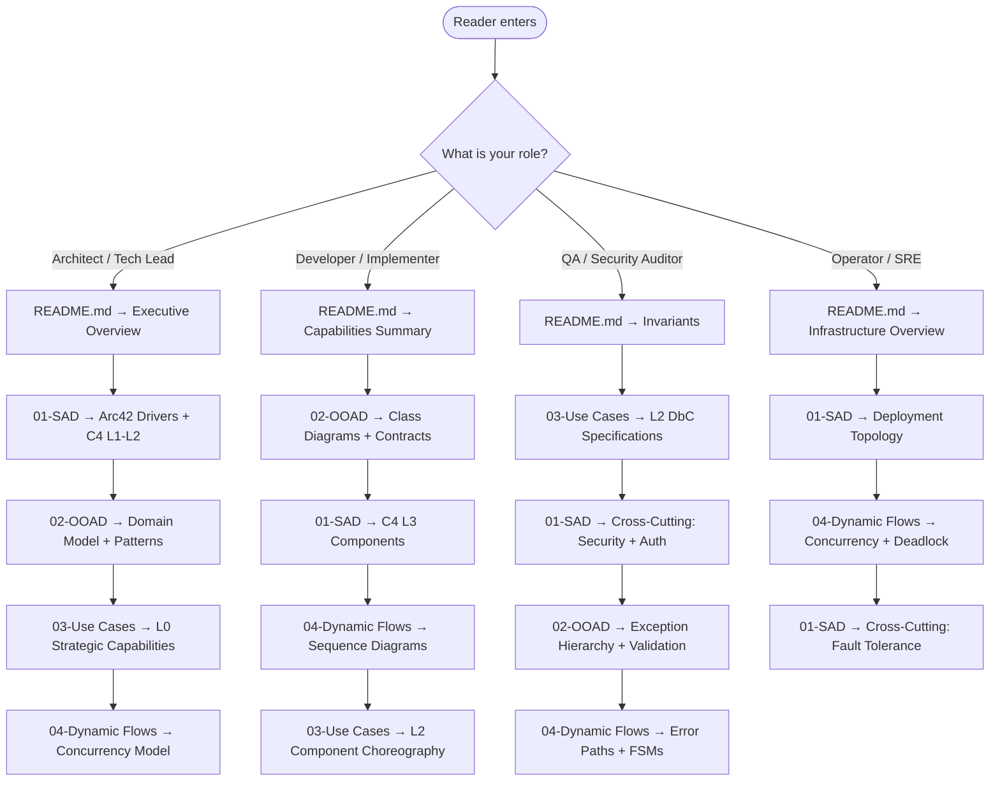

# Rezekify — Master Architectural Index & Executive Guide

| Field | Value |
|---|---|
| **Document ID** | `ARCH-000` |
| **Version** | `1.0.0` |
| **Frameworks** | Arc42, C4 Model (L1–L3), OOAD/UML 2.5, Cockburn Goal Hierarchy (L0–L3), Kruchten 4+1, Design by Contract |
| **Target Environment** | Docker Compose (PostgreSQL 16 + FastAPI + Nginx), Windows/Linux dev |
| **Repository** | `docs/architecture/` |

---

## Executive Overview

### System Identity

Rezekify is an **Autonomous Multi-Modal Personal Finance Manager & Deterministic Runway Engine** — a full-stack system that translates natural language, receipt images, and voice notes into deterministic double-entry ledger mutations, computes a real-time daily safe spending threshold, and surfaces H-7 upcoming bill alerts.

### Strategic Pillars

```
┌─────────────────────────────────────────────────────────────┐
│                    REZEKIFY ARCHITECTURE                     │
├──────────────┬──────────────┬───────────────┬───────────────┤
│  DETERMINISM │  MULTI-MODAL │  ZERO-COST AI │  ZERO-BLOAT   │
│              │              │               │               │
│ decimal.     │ Text + Image │ RotaryKeyPool │ Daily Runway  │
│ Decimal      │ + Voice +    │ Gemini Flash  │ + H-7 Bills   │
│ double-entry │ Telegram Bot │ + Groq + BYOK │ Nothing else  │
│ balanced     │ NL→Ledger    │ free-tier     │ until needed  │
│ ledger       │ mutations    │ resilience    │               │
└──────────────┴──────────────┴───────────────┴───────────────┘
```

---

## Core Architectural Capabilities

- **Deterministic Double-Entry Ledger** — Every financial mutation produces balanced DEBIT/CREDIT `LedgerEntry` pairs using `decimal.Decimal`; the LLM never touches arithmetic.
- **Daily Safe Runway Engine** — Computes `operational_free_cash / days_remaining_in_cycle` with TTL-cached results, vault-locked reserves deduction, and traffic-light health status.
- **Multimodal Agentic NL Parser** — `ReActAgent` extracts structured transaction entities from text, receipt images (Gemini Vision OCR), and voice notes (1-Hop Gemini Audio or 2-Hop Groq Whisper→LLM fallback).
- **Rotary Key Pool with Failover** — Round-robin API key rotation across Gemini and Groq pools with per-key cooldown tracking, automatic rate-limit bypass, and zero-cost free-tier resilience.
- **BYOK (Bring Your Own Key) Multi-Protocol** — Users configure custom AI endpoints (OpenAI-compatible or Anthropic Messages API) with encrypted-at-rest API keys (Fernet PBKDF2).
- **Telegram Gateway Bot** — Webhook-driven bot supporting text commands, receipt photo OCR, and voice note transcription with OTP pairing codes.
- **Row-Level Tenant Isolation** — All database queries enforce `user_id` filtering; JWT access/refresh token pair with HttpOnly cookie rotation.
- **Purchase Simulation Engine** — Projects the impact of a discretionary purchase on the daily safe runway before committing.

---

## Master Navigation Matrix

| # | Document | Scope | Target Audience | Primary Artifacts | File |
|---|----------|-------|-----------------|-------------------|------|
| 0 | **README.md** (this file) | Index, executive summary, reading paths | All stakeholders | Navigation matrix, reading path flowchart | `docs/architecture/README.md` |
| 1 | **System Architecture Document** | Arc42 drivers, C4 L1–L3, cross-cutting concerns, deployment | Architects, Tech Leads, SREs | Context/Container/Component diagrams, sequence walkthroughs | `docs/architecture/01-SYSTEM-ARCHITECTURE-DOCUMENT.md` |
| 2 | **OOAD Specification** | Domain model, UML class diagrams, GoF patterns, exception hierarchy | Developers, Implementers | Class diagrams, pattern catalog, invariant tables | `docs/architecture/02-OOAD-SPECIFICATION.md` |
| 3 | **Use Case Catalog (L0–L3)** | Cockburn altitude decomposition, DbC specifications | QA, Product, Architects | Use case matrices, DbC tables, enterprise boundary diagrams | `docs/architecture/03-USE-CASE-CATALOG-L0-TO-L3.md` |
| 4 | **Dynamic Interaction Flows** | Sequence diagrams, FSM specifications, concurrency models | Developers, SREs | Mermaid sequence/state diagrams, concurrency analysis | `docs/architecture/04-DYNAMIC-INTERACTION-FLOWS.md` |

---

## Tailored Reading Paths



---

## Key Source File Inventory

### Backend (`rezekify/`)

| Module | Key Files | Purpose |
|--------|-----------|---------|
| `core/` | `config.py`, `security.py`, `crypto.py`, `rate_limit.py` | Settings, JWT/bcrypt, Fernet encryption, sliding-window rate limiter |
| `db/` | `models.py`, `session.py`, `init_db.py`, `migrations/` | SQLAlchemy ORM models (9 tables), engine factory, Alembic migrations (6 versions) |
| `services/` | `ledger.py`, `runway.py`, `auth.py` | Deterministic ledger ops, runway calculator, auth/pairing |
| `agent/` | `orchestrator.py`, `runtime.py`, `key_pool.py`, `providers/` | NL→ledger orchestration, ReActAgent multimodal runtime, key rotation, BYOK adapters |
| `api/v1/` | `auth_router.py`, `dashboard_router.py`, `transactions_router.py`, `accounts_router.py`, `categories_router.py`, `vaults_router.py`, `gateway_router.py`, `settings_router.py` | REST API layer (9 routers) |
| `gateway/` | `telegram_bot.py` | Telegram webhook dispatcher |
| `schemas/` | `chat.py`, `settings.py` | Pydantic v2 request/response schemas |

### Frontend (`frontend/src/`)

| Module | Key Files | Purpose |
|--------|-----------|---------|
| `components/` | `AIChatView.tsx`, `AISpotlightHero.tsx`, `RunwayMetricCard.tsx`, `OverviewView.tsx`, `ExpenseCharts.tsx`, `TransactionsTable.tsx`, `VaultCard.tsx`, `SettingsModal.tsx` | UI components |
| `hooks/` | `useDashboardData.ts`, `useDashboardModals.ts`, `useTransactionsLedger.ts` | Data-fetching and state hooks |
| `services/` | `apiClient.ts` | Authenticated HTTP client with token refresh |
| `types/` | `api.ts` | TypeScript API contract types |
| `context/` | `AuthContext.tsx` | JWT auth context provider |

### Infrastructure

| File | Purpose |
|------|---------|
| `docker-compose.yml` | 3-service topology: PostgreSQL 16, FastAPI backend, Nginx frontend |
| `Dockerfile.backend` | Multi-stage Python 3.12-slim build with non-root user |
| `alembic.ini` | Alembic migration configuration |
| `pyproject.toml` | Python dependencies and tool configuration |
